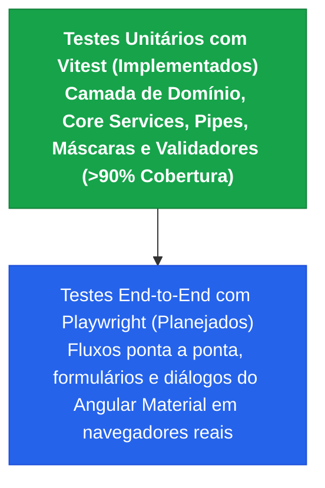
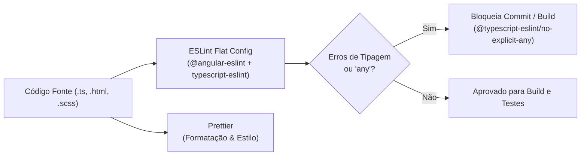

# Arquitetura Geral da Solução
## Sistema de Gerenciamento de Animais Resgatados (*Peludinhos do Vale*)

---

**Instituição:** Universidade Feevale  
**Curso:** Engenharia da Computação  
**Trabalho de Conclusão de Curso (TCC)**  
**Projeto:** DESENVOLVIMENTO E VALIDAÇÃO DE SOFTWARE DE GERENCIAMENTO DE DADOS CADASTRAIS DE ANIMAIS DE ONGS DE ACOLHIMENTO E TRATAMENTO DE ANIMAIS DE RUA  
**Versão:** 1.1.0 — Outubro de 2026  

---

## 1. Visão Geral e Fundamentação da Arquitetura

A definição da arquitetura de software estabelece a estrutura organizacional dos componentes do sistema, suas interfaces externas e o padrão de comunicação que viabiliza o atendimento aos requisitos funcionais e não funcionais projetados (Pressman e Maxim, 2016; Sommerville, 2018).

Para atender aos critérios de usabilidade móvel, baixo tempo de resposta, segurança de acesso e custo nulo de infraestrutura exigidos pela ONG *Peludinhos do Vale*, a solução foi concebida sob uma arquitetura descentralizada e desacoplada em três camadas principais:

1. **Camada de Apresentação (Frontend SPA):** Single Page Application desenvolvida no framework Angular 20, utilizando a arquitetura Zoneless com reatividade granular alimentada por Signals e Computed Signals para otimizar o ciclo de renderização e reduzir o consumo de memória nos dispositivos dos voluntários (Angular, 2026). A interface é organizada sob o padrão *Feature-Based Design*, dividida entre um módulo central (*Core*) para serviços globais e autenticação, componentes compartilhados (*Shared*) e módulos de negócio autocontidos com carregamento tardio (*Lazy Loading*). A estilização e a ergonomia de telas adaptáveis a desktops e smartphones são providas pela integração entre Bootstrap e Angular Material, garantindo a alternância de temas claro e escuro e a observância às diretrizes de acessibilidade e alvos de toque (Dalmazo, 2024; Marcotte, 2010).

2. **Camada de Serviços e Persistência (BaaS - Supabase):** A comunicação entre o cliente web e a Camada de Serviços ocorre de forma assíncrona por meio de requisições HTTPS utilizando tokens de autenticação JSON Web Token (JWT) enviados no cabeçalho das requisições (RFC 7519). A camada de backend é provida pela plataforma Backend-as-a-Service (BaaS) Supabase, a qual encapsula o SGBDR PostgreSQL, cujos scripts de migração, políticas RLS e Edge Functions estão versionados no repositório [backend-supabase](https://github.com/brunnokerber/backend-supabase). O acesso aos dados é realizado diretamente via biblioteca Client SDK ou por APIs REST geradas dinamicamente pelo PostgREST, eliminando a necessidade de um servidor de aplicação intermediário mantido pela instituição (Supabase, 2024). A segurança da informação é assegurada nativamente no banco de dados por meio de políticas de Row Level Security (RLS), que interceptam cada consulta e validam os privilégios do perfil autenticado (`admin` ou `user`). A função central de segurança `public.is_admin()` adota validação de contexto HTTP via `auth.role()`: quando acionada via API REST autenticada, ela valida rigorosamente se o usuário possui `role = 'admin'`, está ativo e não excluído na tabela `public.profiles`, contornando a particularidade de funções `SECURITY DEFINER` (nas quais `current_user` sempre assume a identidade do proprietário da função), e liberando acessos de superusuário apenas para sessões locais de terminal e migrações (`auth.role() IS NULL AND session_user IN ('postgres', 'supabase_admin')`). Tarefas de processamento sensível (como desativação síncrona de usuários no Auth) são delegadas a Edge Functions executadas em ambiente isolado na nuvem.

3. **Camada de Automação e Infraestrutura (DevOps):** Sustenta a qualidade, a manutenibilidade e a entrega contínua da aplicação web. O código-fonte é versionado em repositório no GitHub sob controle de versão distribuído via Git. Integrada ao repositório, uma esteira automatizada de Integração e Entrega Contínuas (CI/CD) construída com GitHub Actions é disparada a cada atualização no código, executando sequencialmente os passos de validação sintática (lint/formatação via Prettier), testes unitários e medição da cobertura de código (*Code Coverage*) com Vitest (V8 Coverage) em ambiente headless JSDOM, e compilação de pacotes (build) antes de realizar o deploy automático da aplicação para a hospedagem em nuvem na Vercel (Rêgo Neto, 2021).

---

## 2. Diagrama Arquitetural da Solução


> 📁 **Arquivo Fonte Editável:** O arquivo de modelagem vetorial está disponível em [`docs/Arquitetura do sistema.drawio`](./Arquitetura%20do%20sistema.drawio) e pode ser aberto diretamente no [draw.io](https://app.diagrams.net/).

---

## 3. Resumo dos Componentes por Camada

| Camada | Componente / Tecnologia | Responsabilidade Principal |
| :--- | :--- | :--- |
| **Apresentação (Frontend)** | **Angular 20 (Zoneless + Signals)** | Gestão de estado reativo fino, roteamento de telas com Lazy Loading e renderização otimizada. |
| | **Angular Material 20 + Bootstrap 5** | Design System responsivo, temas Light/Dark e componentes acessíveis com alvos de toque ergonômicos. |
| | **Core, Features & Shared Services** | Serviços de negócio e infraestrutura (`AuthService`, `SupabaseService`, `AuditResolverService` com cache em memória e deduplicação de requisições, `PetsService`, `VacinasService`, `DoacoesService`, `DoacoesMonetariasService`, `DespesasService`, `FinanceiroService`, `FinanceiroReportService`, `PetReportService` para relatórios Excel/PDF client-side), guardas de rota (`authGuard`, `adminGuard`), componentes e páginas de negócio orquestradoras com decomposição de subcomponentes (`MainLayoutComponent` composto por `MainNavbarComponent`, `UserSidenavComponent` e `MainFooterComponent`; `PetDetailComponent` composto por `PetDetailHeaderComponent`, `PetInfoCardComponent`, `PetVacinasCardComponent`, `PetProcedimentosCardComponent` e `PetLocaisCardComponent`; `FinanceiroDashboardComponent` composto por `FinanceiroFluxoTabComponent` e `FinanceiroDespesasTabComponent` para inteligência orçamentária e despesas; `DoacaoListComponent` composto por `DoacoesInsumosTabComponent`, `DoacoesMonetariasTabComponent` e `DoacoesDirecionamentosTabComponent` para controle de insumos físicos, doações monetárias e direcionamentos consolidados; `CalendarioVacinalComponent` para planejamento e gestão de imunizações em grade mensal e agenda cronológica, `PetListComponent`), componentes reutilizáveis (cabeçalho padronizado via `PageHeaderComponent`, cartões modulares de indicadores via `StatCardComponent`, painel unificado de filtros via `FilterPanelComponent`, layout padronizado de modais via `DialogLayoutComponent`, badge interativo de auditoria via `AuditBadgeComponent` com popover de inspeção, modais de negócio `DespesaDialogComponent`, `DoacaoDialogComponent`, `DirecionamentoDialogComponent`, `DoacaoMonetariaDialogComponent`, `VacinaDialogComponent`, `AdotarPetDialogComponent`, `ConfirmationDialogComponent`, `ImageCropperDialogComponent` e `ImagePreviewDialogComponent`). |
| **Comunicação** | **HTTPS / TLS 1.3 & JWT (RFC 7519)** | Tráfego criptografado e autenticação stateless com tokens no header `Authorization: Bearer <token>`. |
| **Serviços e Banco (BaaS)** | **Supabase Auth (GoTrue)** | Gestão rigorosa de sessões com timebox de 24h e timeout de inatividade de 8h (`onAuthStateChange`), política estrita de senhas fortes (mínimo de 8 caracteres com maiúsculas, minúsculas, dígitos e símbolos, com validação reativa no frontend e rejeição nativa HTTP 422 `weak_password`), signup fechado (`signup_disabled`), proteção na troca de credencial exigindo login recente (`secure_password_change: true`), criptografia de credenciais, disparo de convites administrativos (`invite-user`) e recuperação de senhas. |
| **PostgREST API Engine** | Interface RESTful gerada automaticamente sobre o schema relacional do PostgreSQL. |
| | **SGBDR PostgreSQL & RLS** | Persistência relacional (`pets`, `entradas`, `vacinas`, `consultas_exames`, `locais`, `pets_locais`, `veterinarios`, `voluntarios`, `doacoes`, `direcionamento_doacoes`, `doacoes_monetarias`, `despesas`, `profiles`), view consolidada de livro-caixa (`vw_fluxo_caixa`), segurança a nível de linha e bloqueio de DELETE em tabelas primárias para proteção de histórico. Exclusões físicas são expressamente permitidas apenas em 5 tabelas de exceção operacional (`vacinas`, `consultas_exames`, `direcionamento_doacoes`, `doacoes_monetarias`, `despesas`), com governança estrita e exclusividade via `is_admin()` tanto nas políticas RLS do PostgreSQL quanto nos guards e signals do frontend. |
| | **Stored Procedures / RPCs** | Transações ACID atômicas (`create_pet_com_entrada`, `update_pet_com_entrada`, `adotar_pet`) para inserção/edição consistente e transferência de adoção com rollback automático e persistência de `foto_url`. |
| | **Supabase Storage (Bucket 'pets')** | Armazenamento de fotos de perfil com bucket privado (`public = false`), limite de 256 KB (262.144 bytes, dimensionado para suportar mais de 4.000 imagens na franquia gratuita de 1.000 MB), formatos JPEG/PNG/WebP e URLs assinadas (`createSignedUrl`) com validade de 1 hora. Enquadramento e compressão inteligente executados no cliente via Canvas antes do envio. |
| | **Edge Functions (Deno / Serverless)** | Processamento administrativo sensível em nuvem isolada (`toggle-user-status`). |
| **DevOps & Infraestrutura** | **GitHub (Git)** | Controle de versão distribuído do código-fonte e histórico de commits. |
| | **GitHub Actions (CI/CD)** | Automação sequencial de Validação de Formatação (Prettier), Testes Unitários e Cobertura (Vitest), Build de Produção e Deploy contínuo para Vercel. |
| | **Vitest & V8 Code Coverage** | Motor moderno e veloz de testes unitários em ambiente headless JSDOM, com geração de cobertura via `@vitest/coverage-v8` (relatórios `text`, `lcov` e `json-summary`) para validação local e em esteira CI/CD. |
| | **Prettier** | Padronização e formatação automática de código com regras estritas (`.prettierrc`) e script de verificação (`npm run format:check`). |
| | **Vercel CDN Hosting** | Distribuição global de alta disponibilidade da SPA Angular com CDN e SSL automático. |

### 3.1. Matriz de Governança e Regras de Exceção para Exclusão Física (RLS + RBAC)

A integridade referencial e a rastreabilidade histórica constituem pilares fundamentais do sistema. Para evitar a perda de dados operacionais e o surgimento de registros órfãos, o sistema adota uma política arquitetural em duas categorias:

1. **Tabelas Primárias / Entidades Fundamentais (Hard Delete Bloqueado):**  
   As tabelas `pets`, `locais`, `veterinarios`, `entradas`, `voluntarios` e `profiles` **não possuem permissão de exclusão física (`DELETE`)**. O ciclo de vida dessas entidades é controlado por estados operacionais ou inativação lógica (*Soft Delete* via coluna `ativo = false`), garantindo a preservação eterna do histórico de triagem, adoção e auditoria.

2. **Tabelas Operacionais de Exceção (Exclusão Física Permitida Exclusivamente para `admin`):**  
   Em virtude de necessidades práticas de retificação de lançamentos errôneos, correções de dosagens ou estornos de distribuição de suprimentos, 5 tabelas possuem permissão de exclusão física, condicionada estritamente ao papel de **Administrador (`role = 'admin'`)**:

| Tabela Relacional | Finalidade do Registro | Permissão de DELETE | Regra de Segurança RLS (PostgreSQL) | Salvaguarda no Frontend (Angular) |
| :--- | :--- | :---: | :--- | :--- |
| **`public.vacinas`** | Imunizações aplicadas ou previstas | **Apenas Admin** | `Admins can delete vacinas` (`public.is_admin()`) | Botão de exclusão condicionado a `isAdmin()` no prontuário (`pet-detail`) e no diálogo (`vacina-dialog`) com modal de confirmação. |
| **`public.consultas_exames`** | Consultas, cirurgias e exames | **Apenas Admin** | `Admins can delete consultas_exames` (`public.is_admin()`) | Botão de exclusão condicionado a `isAdmin()` na tabela de procedimentos (`pet-detail`) e no formulário de edição (`procedimento-form`). |
| **`public.direcionamento_doacoes`** | Rateio de insumos para lares parceiros | **Apenas Admin** | `Admins can delete direcionamento_doacoes` (`public.is_admin()`) | Botões de exclusão/estorno desabilitados (`[disabled]="!isAdmin()"`) no painel Master-Detail e na tabela consolidada (`doacao-list`). |
| **`public.doacoes_monetarias`** | Livro-caixa e doações em dinheiro/PIX | **Apenas Admin** | `Admins can delete doacoes_monetarias` (`public.is_admin()`) | Botão de exclusão desabilitado para operadores comuns na aba financeira (`doacao-list`) com confirmação destrutiva. |
| **`public.despesas`** | Despesas institucionais e saídas operacionais | **Apenas Admin** | `Admins can delete despesas` (`public.is_admin()`) | Botão de exclusão condicionado a `isAdmin()` no diálogo (`despesa-dialog`) e na tabela de despesas (`financeiro-dashboard`). |

### 3.2. Rastreamento Automático de Autoria e Trilha de Auditoria (Audit Trail - `updated_by`)

A rastreabilidade de autoria de modificações foi padronizada em nível de banco de dados para todas as 13 tabelas de entidades do sistema (`profiles`, `pets`, `entradas`, `veterinarios`, `vacinas`, `consultas_exames`, `locais`, `doacoes`, `direcionamento_doacoes`, `pets_locais`, `voluntarios`, `doacoes_monetarias` e `despesas`):

1. **Definição da Coluna no Esquema Relacional:**
   - Coluna: `updated_by uuid references public.profiles(id) on delete set null default auth.uid()`.
   - Chave estrangeira com integridade referencial protegida (`on delete set null`).

2. **Automação via Trigger Central (`handle_updated_at`):**
   - Na migração `20260831000001_create_update_at_function.sql`, a função de gatilho atribui automaticamente:
     ```sql
     new.updated_at = timezone('utc', now());
     new.updated_by = coalesce(auth.uid(), new.updated_by, old.updated_by);
     ```
   - **Na criação (`INSERT`):** Se executado por um usuário autenticado na aplicação, o `auth.uid()` é gravado via valor `DEFAULT`.
   - **Na alteração (`UPDATE`):** O trigger captura diretamente o identificador do usuário a partir do token JWT da sessão ativa (`auth.uid()`), atribuindo a autoria da última alteração sem depender de envio manual de campos no payload do frontend.

3. **Consumo, Apresentação e Popover de Auditoria no Frontend (Angular 20):**
   - **Zero Custo de Cotas e Alta Performance:** As requisições usuais selecionam os dados sem realizar joins pesados em todas as entidades ($N+1$).
   - **Serviço Singleton de Resolução com Cache em Memória (`AuditResolverService`):** Implementa cache em memória `Map<string, UserProfile>` com tempo de resposta de $0\text{ ms}$ em consultas subsequentes e deduplicação de requisições simultâneas.
   - **Componente Reutilizável de Auditoria (`AuditBadgeComponent`):** Padroniza a exibição de data de modificação e autor em todos os formulários e diálogos (`pet-form`, `procedimento-form`, `vacina-dialog`, `despesa-dialog`, `doacao-dialog`, `doacao-monetaria-dialog`, `pet-info-card` e `pet-detail-header`):
     - **Para Operadores Comuns (`user`):** Apresenta apenas a data/hora ou pílula estática discreta com o ID, resguardando a privacidade de dados (LGPD).
     - **Para Administradores (`admin`):** O chip de identificação (`ID: a1b2c3...`) é interativo e abre sob demanda um **Popover rico em Angular Material (`mat-menu`)**:
       - Exibe o **E-mail do autor**, botão de cópia de um clique com feedback via toast;
       - Badges coloridos de **Papel** (`Administrador` / `Operador`) e **Status da Conta** (`Ativa` / `Inativa`);
       - UUID completo no Supabase com botão de cópia;
       - Atalho direto de navegação para a tela de gestão de usuários (`/usuarios?search=email`).

### 3.3. Inteligência Financeira e Balanço em Tempo Real via View Consolidada (`public.vw_fluxo_caixa`)

Com a expansão das operações da instituição, surgiu a necessidade de consolidar em um único ponto analítico todas as transações monetárias (entradas e saídas) sem gerar sobrecarga ou duplicação de dados clínicos e administrativos:

1. **Visão Relacional Consolidada (`public.vw_fluxo_caixa`):**
   - Criada com `WITH (security_invoker = true)` para respeitar integralmente as políticas de RLS das tabelas-base de acordo com a sessão do usuário chamador.
   - Consolida dinamicamente 5 fluxos contábeis distintos:
     - **Entradas Institucionais:** `public.doacoes_monetarias` (`tipo_movimentacao = 'Entrada'`, `categoria = 'Doação Monetária'`).
     - **Saídas Gerais / Operacionais:** `public.despesas` (`tipo_movimentacao = 'Saída'`, categorias padronizadas).
     - **Saídas Clínicas:** `public.consultas_exames` com `custo > 0` (`tipo_movimentacao = 'Saída'`, `categoria = 'Consultas & Procedimentos'`).
     - **Saídas Preventivas:** `public.vacinas` com `custo > 0` (`tipo_movimentacao = 'Saída'`, `categoria = 'Vacinas'`).
     - **Saídas de Hospedagem / Estadia:** `public.pets_locais` com `valor_auxilio > 0` (`tipo_movimentacao = 'Saída'`, `categoria = 'Auxílio Lar Temporário'`).
   - Essa abordagem desacoplada permite que os voluntários e veterinários continuem registrando vacinas, consultas e estadias em lares temporários no prontuário do animal com seus respectivos custos e auxílios, e tais valores alimentam automaticamente o fluxo de caixa global da instituição, sem necessidade de re-digitação como despesa avulsa.

2. **Arquitetura de Visualização Leve e Resiliente (Zero Third-Party Chart Libraries):**
   - Em conformidade com a diretriz de desempenho e baixo footprint de bundle da SPA, o painel financeiro descarta deliberadamente o uso de bibliotecas externas pesadas de gráficos (como Chart.js, D3.js ou ApexCharts).
   - As visualizações gráficas de evolução mensal (comparativo de barras verdes para Entradas e vermelhas para Saídas) são renderizadas nativamente através de **elementos vetoriais SVG responsivos (`<svg viewBox="0 0 620 260">`)** combinados com variáveis de cor CSS e transições suaves (`transition: height 0.4s ease`).
   - Essa escolha arquitetural garante carregamento ultrarrápido, compatibilidade imediata com os temas Claro e Escuro sem scripts adicionais e zero vulnerabilidades decorrentes de bibliotecas de terceiros.

3. **Exportação Desacoplada e Prestação de Contas:**
   - O serviço `FinanceiroReportService` implementa exportação client-side de planilhas CSV com sanitização UTF-8 BOM e separador `;` compatível com Excel brasileiro, além de emissão do Balancete Oficial de Prestação de Contas em PDF formatado para impressão com blocos de assinatura para a Diretoria e Conselho Fiscal.

### 3.4. Arquitetura de Componentização Reativa e Decomposição de Abas (Smart Tabs Composition)

Para manter a conformidade com os princípios SOLID — em especial o **Princípio da Responsabilidade Única (Single Responsibility Principle - SRP)** —, as páginas complexas que agrupam múltiplos subdomínios e fluxos operacionais foram decompostas através de um padrão de **Composição de Abas Inteligentes (Smart Tabs)**:

1. **Decomposição do Módulo de Doações (`DoacaoListComponent`):**
   - **Histórico e Problema:** Originalmente, a página concentrava em um único componente monolítico (>1.100 linhas de template e lógica densa) o gerenciamento de insumos físicos com master-detail, cálculo de rateio para lares parceiros, doações monetárias e a consolidação de direcionamentos.
   - **Solução Arquitetural:** O componente pai `DoacaoListComponent` foi refatorado como um orquestrador conciso (<200 linhas), delegando a apresentação e a reatividade para três subcomponentes isolados em `src/app/features/doacoes/pages/doacao-list/tabs/`:
     - **`DoacoesInsumosTabComponent` (`doacoes-insumos-tab`):** Responsável exclusivo pela listagem mestre de insumos físicos (rações, remédios), busca por termos, filtros de saldo (100% Livre, Parcial, Esgotada), KPIs de arrecadação física, tabela master-detail de rateio e acionamento de modais de insumo/direcionamento.
     - **`DoacoesMonetariasTabComponent` (`doacoes-monetarias-tab`):** Responsável exclusivo pelas doações financeiras via PIX/dinheiro, filtros por doador/telefone/período, paginação de transações e salvaguarda de exclusão para administradores.
     - **`DoacoesDirecionamentosTabComponent` (`doacoes-direcionamentos-tab`):** Responsável exclusivo pela visão consolidada de insumos distribuídos por local de acolhimento parceiro com filtros específicos.

2. **Decomposição do Painel Financeiro (`FinanceiroDashboardComponent`):**
   - **Histórico e Problema:** O painel administrativo financeiro reunia visualizações analíticas de fluxo de caixa (gráficos SVG, ranking de animais mais custosos, breakdown por categoria) e o livro-caixa operacional de despesas institucionais em um arquivo único (>700 linhas).
   - **Solução Arquitetural:** O dashboard principal foi convertido em coordenador de alto nível, subdividindo as visões em `src/app/features/financeiro/pages/financeiro-dashboard/tabs/`:
     - **`FinanceiroFluxoTabComponent` (`financeiro-fluxo-tab`):** Concentra a visualização analítica, timeline de movimentações, gráfico comparativo SVG nativo, ranking dos Top 5 pets que mais demandaram recursos e distribuição proporcional por categoria.
     - **`FinanceiroDespesasTabComponent` (`financeiro-despesas-tab`):** Concentra a gestão operacional de despesas avulsas, buscas por favorecido/categoria/datas, tabela com badges de categoria e ações de CRUD com controle RBAC.

3. **Carregamento Tardio de Abas via `<ng-template matTabContent>` (Lazy Tab Rendering):**
   - No Angular Material, a inclusão direta de componentes dentro de `<mat-tab>` causa a instanciação síncrona imediata de todas as abas durante o carregamento da página principal, executando múltiplos subscriptions, computações de signals e renderização de tabelas mesmo que o usuário visualize apenas a primeira aba.
   - A adoção da diretiva estrutural `<ng-template matTabContent>` garante a instanciação estritamente preguiçosa (*Lazy Initialization*): o componente da aba é criado e inserido no DOM somente quando o usuário clica sobre ela. Ao alternar de aba, o estado é preservado de forma eficiente, reduzindo substancialmente o First Contentful Paint (FCP) e o uso de memória.

4. **Isolamento de Testes Unitários:**
   - Cada subcomponente de aba possui sua própria especificação de teste (`.spec.ts`) desacoplada, permitindo a execução de asserções granulares sobre filtros, paginação, interações de tabela e acionamento de diálogos com 100% de previsibilidade e tempos de execução inferiores a 1s por suíte.

### 3.5. Arquitetura Orientada a Componentes e Decomposição de Páginas Complexas (Component-Driven Architecture)

Seguindo os preceitos de alta coesão e baixo acoplamento, a arquitetura do frontend estende o princípio de decomposição por responsabilidade única para o shell global da aplicação e para a visualização central do prontuário individual do animal:

1. **Decomposição do Layout Global (`MainLayoutComponent`):**
   - **Histórico e Problema:** O layout principal consolidava mais de 460 linhas de HTML gerenciando simultaneamente a barra de navegação superior, menu de usuário, badges de perfil, drawer lateral de navegação administrativa, controles de tema e rodapé institucional.
   - **Solução Arquitetural:** O `MainLayoutComponent` foi refatorado para um orquestrador limpo (<30 linhas de template), delegando as interfaces para subcomponentes standalone isolados em `src/app/layout/components/`:
     - **`MainNavbarComponent` (`main-navbar`):** Concentra o cabeçalho superior, identidade visual da ONG, botões de atalho de tela, alternância rápida de tema Claro/Escuro via `ThemeService`, menu suspenso de ações do usuário (`mat-menu`) e gatilho de abertura do drawer lateral.
     - **`UserSidenavComponent` (`user-sidenav`):** Barra lateral retrátil de navegação (`mat-nav-list`), contendo rotas operacionais e administrativas filtradas reativamente por perfil RBAC (`adminGuard`/`isAdmin`), cabeçalho de usuário com badge de autoridade (`admin`/`user`), alternância de tema e ações de perfil/logout.
     - **`MainFooterComponent` (`main-footer`):** Rodapé institucional padronizado exibindo a versão da aplicação (`environment.appVersion`), vínculo acadêmico com a Universidade Feevale e declarações de direitos.

2. **Decomposição do Prontuário Individual do Animal (`PetDetailComponent`):**
   - **Histórico e Problema:** O prontuário do animal representava o maior monolito de template do sistema (>940 linhas de código), congregando cabeçalho executivo, chip de auditoria `updated_by`, formulários de status, cards de triagem, tabelas de vacinas com controle de doses e custos, histórico clínico/cirúrgico com alternância de ordenação e histórico de estadias em lares temporários.
   - **Solução Arquitetural:** O `PetDetailComponent` atua exclusivamente como coordenador e gestor de estado reativo (~65 linhas de template), distribuindo as responsabilidades para 5 subcomponentes em `src/app/features/pets/pages/pet-detail/components/`:
     - **`PetDetailHeaderComponent` (`pet-detail-header`):** Apresenta o cabeçalho do prontuário, avatar do animal com suporte a ampliação em lightbox (`ImagePreviewDialogComponent`), badges de status operacional, contador de dias de acolhimento, totalizador financeiro acumulado, chip de auditoria de última alteração (`updated_by`) com cópia em 1 clique e botões de ação ("Voltar", "Editar" e "Registrar Adoção").
     - **`PetInfoCardComponent` (`pet-info-card`):** Cartão de dados cadastrais gerais: raça, sexo, porte, fase de vida/senioridade calculada, data de nascimento/idade, data de castração, identificadores únicos (Moura, Microchip, RGA), link externo para prontuários em nuvem e histórico completo da entrada/resgate (resgatante, data de entrada, local de origem e notas de triagem).
     - **`PetVacinasCardComponent` (`pet-vacinas-card`):** Cartão especializado no histórico de imunizações, com tabela responsiva de doses aplicadas e previstas, controle de custos, atalho para o Calendário Vacinal global, diálogos de cadastro/edição (`VacinaDialogComponent`) e exclusão restrita a administradores.
     - **`PetProcedimentosCardComponent` (`pet-procedimentos-card`):** Histórico clínico, consultas, exames laboratoriais e procedimentos cirúrgicos, dispondo de ordenação dinâmica ("Cronológica" vs. "Por Valor"), badges de tipagem clínica, custos acumulados e governança RBAC para exclusão.
     - **`PetLocaisCardComponent` (`pet-locais-card`):** Histórico de estadias e passagens por lares temporários, clínicas e abrigos parceiros (`pets_locais`), com detalhamento de datas de entrada/saída, motivos de transferência, valores de auxílio financeiro e acionamento de novas transferências de acomodação.

3. **Ganhos de Manutenibilidade, Performance e Confiabilidade:**
   - **Testabilidade Fina:** Cada cartão possui sua própria especificação de teste (`.spec.ts`) com isolamento completo de dependências e asserções granulares, sem risco de efeitos colaterais entre diferentes seções do prontuário ou do shell.
   - **Prevenção de Regressões:** Modificações em vacinas ou procedimentos não alteram o ciclo de vida ou a árvore DOM dos dados cadastrais do pet ou da navegação do layout.
   - **Reutilização e Legibilidade:** Manutenção facilitada para novas evoluções acadêmicas e operacionais, aderindo integralmente às diretrizes do Clean Code e SOLID.

---

## 4. Estratégia de Indexação e Otimização no PostgreSQL

Com o objetivo de assegurar baixa latência operacional, suporte a conexões móveis e escalabilidade da base de dados, foi implementada uma estratégia completa de indexação relacional nas migrations de infraestrutura (`20261008000011_create_indexes_and_search.sql`, `20261008000012_create_indexes_and_search.sql`) e nas migrations de domínio (`20261024000014_create_doacoes_monetarias.sql`, `20261024000015_create_despesas.sql`) no [backend-supabase](https://github.com/brunnokerber/backend-supabase):

### 4.1. Busca Textual Otimizada por Trigramas (`pg_trgm` + GIN)
As pesquisas parciais executadas pelo frontend via operador `ILIKE '%termo%'` realizavam varredura sequencial (*Sequential Scan*) com complexidade temporal $O(n)$. Com a habilitação da extensão `pg_trgm` e a criação de índices do tipo **GIN (Generalized Inverted Index)** nas colunas textuais, as buscas por substrings foram convertidas para varreduras indexadas (*Bitmap Index Scan*) de alta velocidade:
- `idx_pets_nome_trgm` e `idx_pets_raca_trgm` na tabela `pets`.
- `idx_locais_nome_trgm`, `idx_locais_bairro_trgm` e `idx_locais_cidade_trgm` na tabela `locais`.
- `idx_veterinarios_nome_trgm` na tabela `veterinarios`.
- `idx_voluntarios_nome_trgm` na tabela `voluntarios`.
- `idx_doacoes_doador_trgm` e `idx_doacoes_tipo_trgm` na tabela `doacoes`.
- `idx_doacoes_monetarias_doador_trgm` na tabela `doacoes_monetarias`.
- `idx_despesas_favorecido_trgm` na tabela `despesas`.

### 4.2. Índices GIN em Vetores de Strings (`TEXT[]` para Filtros de Disponibilidade)
A busca por voluntários disponíveis em dias específicos e turnos é executada através do operador de contenção `.contains()` do Supabase (`@>` no PostgreSQL). Foram criados índices GIN dedicados nos arrays:
- `idx_voluntarios_dias_semana` em `voluntarios(dias_semana)`
- `idx_voluntarios_turnos` em `voluntarios(turnos)`

### 4.3. Índices de Chaves Estrangeiras (Foreign Keys)
Para eliminar *table scans* durante operações de junção relacional (JOINs) geradas pelo PostgREST, todas as FKs receberam índices dedicados:
- `idx_entradas_id_pet`, `idx_entradas_id_usuario`
- `idx_vacinas_id_pet`, `idx_vacinas_id_veterinario`
- `idx_consultas_exames_id_pet`, `idx_consultas_exames_id_veterinario`
- `idx_pets_locais_id_pet`, `idx_pets_locais_id_local`
- `idx_direcionamento_doacoes_id_doacao`, `idx_direcionamento_doacoes_id_local`
- `idx_despesas_id_pet`, `idx_despesas_updated_by`

### 4.4. Índices Compostos para Eliminação de Ordenação em Memória (*Sort Elimination*)
As abas do prontuário clínico e histórico de estadias demandam registros filtrados por `id_pet` e ordenados de forma decrescente pela data mais recente (`NULLS LAST`). Foram criados índices compostos cobrindo filtro + ordenação direta:
- `idx_vacinas_pet_data` em `vacinas(id_pet, data_aplicacao DESC NULLS LAST)`
- `idx_consultas_pet_data` em `consultas_exames(id_pet, data_realizacao DESC NULLS LAST)`
- `idx_pets_locais_pet_data` em `pets_locais(id_pet, data_saida DESC NULLS LAST)`
- `idx_voluntarios_created_at_desc` em `voluntarios(created_at DESC)` para ordenação padrão da listagem administrativa.
- `idx_doacoes_monetarias_data` em `doacoes_monetarias(data_doacao DESC)` para ordenação cronológica das contribuições financeiras.
- `idx_despesas_data_despesa` em `despesas(data_despesa DESC)` para filtragem temporal imediata de livro-caixa.
- `idx_despesas_categoria` em `despesas(categoria)` para consolidação e agrupamento de despesas por categoria.

### 4.5. Índices Parciais e Identificadores Únicos
- `idx_pets_chip`, `idx_pets_moura` e `idx_pets_rga` criados com cláusula parcial `WHERE ... IS NOT NULL` para reduzir o tamanho físico do índice e acelerar buscas por identificadores específicos.
- `idx_pets_locais_valor_auxilio` em `pets_locais(valor_auxilio)` com cláusula parcial `WHERE valor_auxilio IS NOT NULL AND valor_auxilio > 0` para aceleração máxima de varredura das saídas de hospedagem na view `vw_fluxo_caixa`.
- `idx_veterinarios_crmv` em árvore B-Tree para buscas diretas por CRMV.
- `idx_pets_filtros` em `(status, tipo_pet, senioridade, porte)` para consultas multicritério combinadas.

### 4.6. Validação Empírica de Desempenho (`EXPLAIN ANALYZE`)
* **Consulta de Prontuário Clínico (`vacinas WHERE id_pet = ?`):** Utilização do índice `idx_vacinas_pet_data` via *Bitmap Index Scan* com tempo de execução aferido de **0.109 ms**.
* **Busca Textual por Substring (`pets WHERE nome ILIKE '%termo%'`):** Resolução instantânea via `idx_pets_nome_trgm` sem overhead de varredura completa de tabela.
* **Filtro de Disponibilidade de Voluntários (`dias_semana @> ARRAY['Sábado']`):** Execução via `idx_voluntarios_dias_semana` com *Bitmap Index Scan*.

---

## 5. Estratégia de Testes Automatizados: Unitários (Vitest) e E2E (Playwright)

Com foco no rigor acadêmico do TCC e na confiabilidade da operação em produção, o sistema adota uma estratégia pragmática e direta de **dois níveis de testes**, sem a sobrecarga de testes de integração intermediários com DOM simulado:



### 5.1. Cobertura Unitária e Isolamento de Regras de Negócio (Vitest)
A camada de **Serviços de Domínio e Core** concentra as regras de negócio críticas e a orquestração do Supabase (BaaS). Todos os serviços foram submetidos a testes unitários estritos com isolamento de dependências via mocks e `provideZonelessChangeDetection()`, abrangendo cenários de sucesso, validações e caminhos de exceção:

| Serviço / Domínio | % Statements | % Funções | % Linhas | Regras de Negócio e Casos de Borda Cobertos |
| :--- | :---: | :---: | :---: | :--- |
| **`AuthService`** | **91.5%** | **100%** | **91.5%** | Login com resolução de perfis via PostgREST, renovação thread-safe de token (`getValidToken` concorrente), mapeamento de erros Supabase (`same_password`, `weak_password`, reautenticação exigida), captura de JWT hash e logout por inatividade. |
| **`PetsService`** | **92.3%** | **100%** | **92.3%** | CRUD de pets, upload/geração de URLs assinadas/exclusão no Supabase Storage, RPC transacional `criar_pet_com_entrada`, RPC `atualizar_pet_com_entrada` e RPC `adotar_pet` com tratamento de falhas. |
| **`VacinasService`** | **96.9%** | **100%** | **96.9%** | Controle de doses previstas e aplicadas, cache local reativo em Signal, cálculo do calendário geral de vacinação, resiliência a falhas de rede e exclusão física de vacinas restrita a administradores. |
| **`LocaisService`** | **100%** | **100%** | **100%** | Gestão de abrigos/lares temporários, consultas multicritério com normalização de telefones e integração assíncrona ao ViaCEP com tolerância a falhas. |
| **`DoacoesService`** | **94.3%** | **100%** | **94.3%** | CRUD de doações com join relacional em cascata, validação de saldos em memória e limites máximos de direcionamento, enriquecimento reativo (status/percentuais) e estorno atômico de saldo na exclusão de direcionamentos (restrita a administradores). |
| **`DoacoesMonetariasService`** | **96.8%** | **100%** | **96.8%** | Registro de doações em dinheiro/PIX, cálculo reativo de KPIs financeiros (Total, Quantidade, Média, Maior Doação), filtros por doador/telefone/período e exclusão com governança RLS restrita a administradores. |
| **`VoluntariosService`** | **100%** | **100%** | **100%** | Escala de voluntariado com operadores de array `@>` do PostgreSQL (`dias_semana`, `turnos`), normalização de dígitos de telefone e soft delete. |
| **`VeterinariosService`** | **100%** | **100%** | **100%** | Registro de médicos veterinários e clínicas parceiras com tratamento de CRMV duplicado e falhas de banco. |
| **`UsuariosService`** | **100%** | **100%** | **100%** | Acionamento da Edge Function `toggle-user-status`, parsing de erros de servidor (`parseFunctionError`), autodesativação de conta e controle RBAC. |
| **`ConsultasExamesService`** | **100%** | **100%** | **100%** | Histórico clínico-cirúrgico, cacheamento por `id_pet`, recarga forçada, gestão de custos veterinários e exclusão física de procedimentos/exames restrita a administradores. |
| **`PetsLocaisService`** | **100%** | **100%** | **100%** | Registro de passagens e histórico de estadias, controle de auxílio financeiro e invalidação de cache. |
| **`PetReportService`** | **95.9%** | **100%** | **95.9%** | Geração e download de relatórios CSV com UTF-8 BOM sanitizado contra CSV Injection, e emissão de relatórios PDF com layout para impressão e sanitização anti-XSS. |
| **`DespesasService`** | **96.8%** | **100%** | **96.8%** | CRUD de despesas institucionais, signals reativos de lista e estado, tratamento de erros e governança de exclusão restrita a administradores. |
| **`FinanceiroService`** | **97.4%** | **100%** | **97.4%** | Agregação contábil via `vw_fluxo_caixa`, KPIs orçamentários, balanço líquido, distribuição por categoria, evolução mensal em timeline e ranking de custos por animal. |
| **`FinanceiroReportService`** | **100%** | **100%** | **100%** | Emissão client-side de balancetes oficiais de prestação de contas em PDF para impressão e exportação de extratos CSV compatíveis com Microsoft Excel. |
| **`AuditResolverService`** | **100%** | **100%** | **100%** | Resolução segura de perfis de usuário por UUID para a trilha de auditoria, salvaguarda de permissão para administradores (RBAC), cacheamento em memória `Map<string, UserProfile>` para resposta $0\text{ ms}$ e deduplicação de requisições concorrentes em voo. |
| **`NavigationService`** | **100%** | **100%** | **100%** | Navegação defensiva com fallback automático para rotas padrão em acessos diretos. |

Além dos serviços de domínio, cada componente decomposto de abas (`DoacoesInsumosTabComponent`, `DoacoesMonetariasTabComponent`, `DoacoesDirecionamentosTabComponent`, `FinanceiroFluxoTabComponent`, `FinanceiroDespesasTabComponent`), os subcomponentes modulares de shell (`MainNavbarComponent`, `UserSidenavComponent`, `MainFooterComponent`), os subcomponentes isolados do prontuário (`PetDetailHeaderComponent`, `PetInfoCardComponent`, `PetVacinasCardComponent`, `PetProcedimentosCardComponent`, `PetLocaisCardComponent`) e o componente de auditoria (`AuditBadgeComponent`) possuem suítes unitárias dedicadas testando inicialização, renderização condicional, filtragens de signals, manipulação de inputs/outputs e acionamento de diálogos modais, totalizando **63 arquivos de teste e 459 testes unitários automatizados com 100% de aprovação no Vitest**.

### 5.2. Justificativa Técnica para a Escolha: Unitários + E2E (Playwright)
Optou-se deliberadamente por focar nos testes unitários rápidos e no isolamento de componentes:

1. **Eficiência e Rigor no Pipeline:** 
   - **Camada Unitária (Vitest):** Valida de forma instantânea (~15s) toda a lógica de negócio, transformações, cálculos de datas, regras de sanitização, resiliência a erros, persistência e estados de interface dos componentes decompostos.
   - **Camada End-to-End (Playwright - Planejada):** Assumirá a responsabilidade de verificar os fluxos visuais reais do usuário (preenchimento de formulários, abertura de diálogos, máscaras de input, alertas visuais e navegação entre páginas) diretamente em navegadores reais (Chromium, Firefox, WebKit).

---

## 6. Qualidade de Código, Tipagem Estrita e Padronização (ESLint + Prettier)

Para assegurar manutenibilidade a longo prazo, consistência arquitetural e conformidade com os princípios da Engenharia de Software no TCC, o projeto adota um ferramental automatizado de análise estática e formatação:



### 6.1. Análise Estática com ESLint (Flat Config)
* **Arquitetura Moderna Flat Config (`eslint.config.js`):** Integrado ao ecossistema do Angular 20 via `@angular-eslint/schematics`, processando tanto componentes TypeScript quanto templates inline e arquivos HTML dedicados.
* **Política Mandatória de Zero `any` (`@typescript-eslint/no-explicit-any: "error"`):** O uso de `any` é explicitamente bloqueado pelo linter em todo o código de produção (`**/*.ts`), obrigando o uso de tipagem estrita com interfaces, tipos genéricos e type guards seguros com `unknown` (`err instanceof Error`, `extractErrorMessage`).
* **Boas Práticas Angular:** Validação automatizada de convenções de seletores (`app-*`), ciclo de vida de componentes e templates limpos.
* **Comando de Execução:** `npm run lint`.

### 6.2. Padronização Visual e Estilística com Prettier
* **Configuração Única (`.prettierrc`):** Unifica largura de linha (100 colunas), aspas simples, ponto-e-vírgula e indentação de 2 espaços em todas as linguagens do projeto (`.ts`, `.html`, `.scss`, `.json`).
* **Comandos de Execução:** `npm run format` (reescrita) e `npm run format:check` (validação em CI/CD).

### 6.3. Esteiras Automatizadas de CI/CD (GitHub Actions - `ci.yml` e `deploy.yml`)
Tanto a validação em desenvolvimento (*Pull Requests* e *Pushes* via `ci.yml`) quanto a esteira de publicação em produção na Vercel (`deploy.yml` na branch `master`) compartilham os mesmos estágios sequenciais de validação (*Quality Gates*):
1. **Validação de Formatação:** Execução do `npm run format:check` para garantir conformidade com o Prettier.
2. **Análise Estática e Tipagem Estrita:** Execução do `npm run lint` assegurando conformidade com o ESLint e impedindo a introdução de `any`.
3. **Testes Unitários e Cobertura:** Execução do `npm run test:coverage` via Vitest com retenção do artefato de cobertura de código.
4. **Build e Deploy de Produção:** No CI, validação do bundle com `npm run build`; no pipeline de produção, acionamento do build e deploy atômico na Vercel via Vercel CLI.


