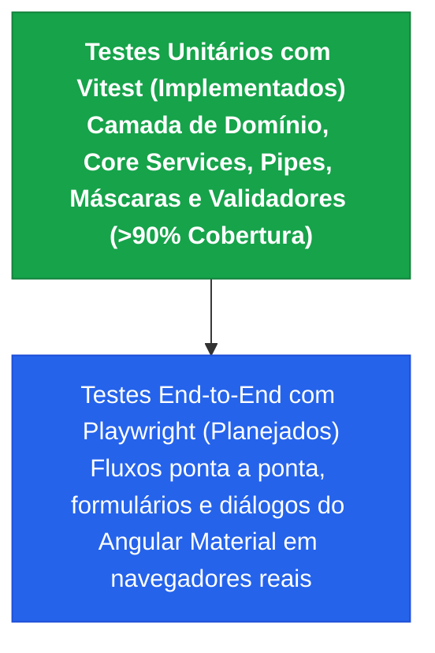
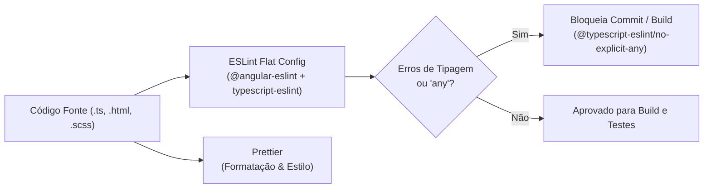

# Arquitetura Geral da Solução
## Sistema de Gerenciamento de Animais Resgatados (*Peludinhos do Vale*)

---

**Instituição:** Universidade Feevale  
**Curso:** Engenharia da Computação  
**Trabalho de Conclusão de Curso (TCC)**  
**Projeto:** DESENVOLVIMENTO E VALIDAÇÃO DE SOFTWARE DE GERENCIAMENTO DE DADOS CADASTRAIS DE ANIMAIS DE ONGS DE ACOLHIMENTO E TRATAMENTO DE ANIMAIS DE RUA  
**Versão:** 1.1.0 — Outubro de 2026  

---

## 1. Visão Geral e Fundamentação da Arquitetura

A definição da arquitetura de software estabelece a estrutura organizacional dos componentes do sistema, suas interfaces externas e o padrão de comunicação que viabiliza o atendimento aos requisitos funcionais e não funcionais projetados (Pressman e Maxim, 2016; Sommerville, 2018).

Para atender aos critérios de usabilidade móvel, baixo tempo de resposta, segurança de acesso e custo nulo de infraestrutura exigidos pela ONG *Peludinhos do Vale*, a solução foi concebida sob uma arquitetura descentralizada e desacoplada em três camadas principais:

1. **Camada de Apresentação (Frontend SPA):** Single Page Application desenvolvida no framework Angular 20, utilizando a arquitetura Zoneless com reatividade granular alimentada por Signals e Computed Signals para otimizar o ciclo de renderização e reduzir o consumo de memória nos dispositivos dos voluntários (Angular, 2026). A interface é organizada sob o padrão *Feature-Based Design*, dividida entre um módulo central (*Core*) para serviços globais e autenticação, componentes compartilhados (*Shared*) e módulos de negócio autocontidos com carregamento tardio (*Lazy Loading*). A estilização e a ergonomia de telas adaptáveis a desktops e smartphones são providas pela integração entre Bootstrap e Angular Material, garantindo a alternância de temas claro e escuro e a observância às diretrizes de acessibilidade e alvos de toque (Dalmazo, 2024; Marcotte, 2010).

2. **Camada de Serviços e Persistência (BaaS - Supabase):** A comunicação entre o cliente web e a Camada de Serviços ocorre de forma assíncrona por meio de requisições HTTPS utilizando tokens de autenticação JSON Web Token (JWT) enviados no cabeçalho das requisições (RFC 7519). A camada de backend é provida pela plataforma Backend-as-a-Service (BaaS) Supabase, a qual encapsula o SGBDR PostgreSQL, cujos scripts de migração, políticas RLS e Edge Functions estão versionados no repositório [backend-supabase](https://github.com/brunnokerber/backend-supabase). O acesso aos dados é realizado diretamente via biblioteca Client SDK ou por APIs REST geradas dinamicamente pelo PostgREST, eliminando a necessidade de um servidor de aplicação intermediário mantido pela instituição (Supabase, 2024). A segurança da informação é assegurada nativamente no banco de dados por meio de políticas de Row Level Security (RLS), que interceptam cada consulta e validam os privilégios do perfil autenticado (`admin` ou `user`), enquanto tarefas de processamento sensível (como desativação síncrona de usuários) são delegadas a Edge Functions executadas em ambiente isolado na nuvem.

3. **Camada de Automação e Infraestrutura (DevOps):** Sustenta a qualidade, a manutenibilidade e a entrega contínua da aplicação web. O código-fonte é versionado em repositório no GitHub sob controle de versão distribuído via Git. Integrada ao repositório, uma esteira automatizada de Integração e Entrega Contínuas (CI/CD) construída com GitHub Actions é disparada a cada atualização no código, executando sequencialmente os passos de validação sintática (lint/formatação via Prettier), testes unitários e medição da cobertura de código (*Code Coverage*) com Vitest (V8 Coverage) em ambiente headless JSDOM, e compilação de pacotes (build) antes de realizar o deploy automático da aplicação para a hospedagem em nuvem na Vercel (Rêgo Neto, 2021).

---

## 2. Diagrama Arquitetural da Solução

> 📁 **Arquivo Fonte Editável:** O arquivo de modelagem vetorial está disponível em [`docs/Arquitetura do sistema.drawio`](./Arquitetura%20do%20sistema.drawio) e pode ser aberto diretamente no [draw.io](https://app.diagrams.net/).

---

## 3. Resumo dos Componentes por Camada

| Camada | Componente / Tecnologia | Responsabilidade Principal |
| :--- | :--- | :--- |
| **Apresentação (Frontend)** | **Angular 20 (Zoneless + Signals)** | Gestão de estado reativo fino, roteamento de telas com Lazy Loading e renderização otimizada. |
| | **Angular Material 20 + Bootstrap 5** | Design System responsivo, temas Light/Dark e componentes acessíveis com alvos de toque ergonômicos. |
| | **Core, Features & Shared Services** | Serviços de negócio e infraestrutura (`AuthService`, `SupabaseService`, `PetsService`, `VacinasService`, `PetReportService` para relatórios Excel/PDF client-side), guardas de rota (`authGuard`, `adminGuard`), componentes e páginas de negócio (`CalendarioVacinalComponent` para planejamento e gestão de imunizações em grade mensal e agenda cronológica com cabeçalho unificado `PageHeaderComponent`, cards dedicados de KPIs via `StatCardComponent` para doses previstas, aplicadas e atrasadas, e navegação simplificada mês a mês, `PetDetailComponent`, `PetListComponent` com cards móveis ergonômicos dotados de botão primário flexível e menu contextual de ações via `MatMenu`), componentes reutilizáveis (cabeçalho padronizado de páginas via `PageHeaderComponent` com ícone, título semântico, descrição contextual e slot de ações responsivo, cartões modulares de indicadores/estatísticas via `StatCardComponent` / `KpiCardComponent` encapsulando variantes semânticas, alinhamento e ícones, painel unificado de busca e filtros via `FilterPanelComponent` com content projection de inputs específicos e botões DRY de Filtrar e Limpar, layout padronizado de modais via `DialogLayoutComponent` com slots estruturais para Header, Body seguro contra clipping e Actions, `VacinaDialogComponent` para cadastro/edição e aplicação rápida de vacinas com badge verde reativa, `AdotarPetDialogComponent` para o fluxo ágil e atômico de adoção definitiva com cadastro inline de adotante, `ConfirmationDialogComponent`, `AlterarSenhaDialogComponent` com reautenticação recente, `PasswordRequirementsComponent` para validação reativa de senhas fortes, `ImagePreviewDialogComponent` para visualização ampliada tipo lightbox e `ImageCropperDialogComponent` para enquadramento/recorte e compressão pré-upload em Canvas). |
| **Comunicação** | **HTTPS / TLS 1.3 & JWT (RFC 7519)** | Tráfego criptografado e autenticação stateless com tokens no header `Authorization: Bearer <token>`. |
| **Serviços e Banco (BaaS)** | **Supabase Auth (GoTrue)** | Gestão rigorosa de sessões com timebox de 24h e timeout de inatividade de 8h (`onAuthStateChange`), política estrita de senhas fortes (mínimo de 8 caracteres com maiúsculas, minúsculas, dígitos e símbolos, com validação reativa no frontend e rejeição nativa HTTP 422 `weak_password`), signup fechado (`signup_disabled`), proteção na troca de credencial exigindo login recente (`secure_password_change: true`), criptografia de credenciais, disparo de convites administrativos (`invite-user`) e recuperação de senhas. |
| **PostgREST API Engine** | Interface RESTful gerada automaticamente sobre o schema relacional do PostgreSQL. |
| | **SGBDR PostgreSQL & RLS** | Persistência relacional (`pets`, `entradas`, `vacinas`, `consultas_exames`, `locais`, `pets_locais`, `veterinarios`, `voluntarios`, `profiles`), segurança a nível de linha e bloqueio de DELETE em tabelas primárias para proteção de histórico. |
| | **Stored Procedures / RPCs** | Transações ACID atômicas (`create_pet_com_entrada`, `update_pet_com_entrada`, `adotar_pet`) para inserção/edição consistente e transferência de adoção com rollback automático e persistência de `foto_url`. |
| | **Supabase Storage (Bucket 'pets')** | Armazenamento de fotos de perfil com bucket privado (`public = false`), limite de 256 KB (262.144 bytes, dimensionado para suportar mais de 4.000 imagens na franquia gratuita de 1.000 MB), formatos JPEG/PNG/WebP e URLs assinadas (`createSignedUrl`) com validade de 1 hora. Enquadramento e compressão inteligente executados no cliente via Canvas antes do envio. |
| | **Edge Functions (Deno / Serverless)** | Processamento administrativo sensível em nuvem isolada (`toggle-user-status`). |
| **DevOps & Infraestrutura** | **GitHub (Git)** | Controle de versão distribuído do código-fonte e histórico de commits. |
| | **GitHub Actions (CI/CD)** | Automação sequencial de Validação de Formatação (Prettier), Testes Unitários e Cobertura (Vitest), Build de Produção e Deploy contínuo para Vercel. |
| | **Vitest & V8 Code Coverage** | Motor moderno e veloz de testes unitários em ambiente headless JSDOM, com geração de cobertura via `@vitest/coverage-v8` (relatórios `text`, `lcov` e `json-summary`) para validação local e em esteira CI/CD. |
| | **Prettier** | Padronização e formatação automática de código com regras estritas (`.prettierrc`) e script de verificação (`npm run format:check`). |
| | **Vercel CDN Hosting** | Distribuição global de alta disponibilidade da SPA Angular com CDN e SSL automático. |

---

## 4. Estratégia de Indexação e Otimização no PostgreSQL

Com o objetivo de assegurar baixa latência operacional, suporte a conexões móveis e escalabilidade da base de dados, foi implementada uma estratégia completa de indexação relacional nas migrations `20261008000011_create_indexes_and_search.sql` e `20261008000012_create_indexes_and_search.sql` no [backend-supabase](https://github.com/brunnokerber/backend-supabase):

### 4.1. Busca Textual Otimizada por Trigramas (`pg_trgm` + GIN)
As pesquisas parciais executadas pelo frontend via operador `ILIKE '%termo%'` realizavam varredura sequencial (*Sequential Scan*) com complexidade temporal $O(n)$. Com a habilitação da extensão `pg_trgm` e a criação de índices do tipo **GIN (Generalized Inverted Index)** nas colunas textuais, as buscas por substrings foram convertidas para varreduras indexadas (*Bitmap Index Scan*) de alta velocidade:
- `idx_pets_nome_trgm` e `idx_pets_raca_trgm` na tabela `pets`.
- `idx_locais_nome_trgm`, `idx_locais_bairro_trgm` e `idx_locais_cidade_trgm` na tabela `locais`.
- `idx_veterinarios_nome_trgm` na tabela `veterinarios`.
- `idx_voluntarios_nome_trgm` na tabela `voluntarios`.

### 4.2. Índices GIN em Vetores de Strings (`TEXT[]` para Filtros de Disponibilidade)
A busca por voluntários disponíveis em dias específicos e turnos é executada através do operador de contenção `.contains()` do Supabase (`@>` no PostgreSQL). Foram criados índices GIN dedicados nos arrays:
- `idx_voluntarios_dias_semana` em `voluntarios(dias_semana)`
- `idx_voluntarios_turnos` em `voluntarios(turnos)`

### 4.3. Índices de Chaves Estrangeiras (Foreign Keys)
Para eliminar *table scans* durante operações de junção relacional (JOINs) geradas pelo PostgREST, todas as FKs receberam índices dedicados:
- `idx_entradas_id_pet`, `idx_entradas_id_usuario`
- `idx_vacinas_id_pet`, `idx_vacinas_id_veterinario`
- `idx_consultas_exames_id_pet`, `idx_consultas_exames_id_veterinario`
- `idx_pets_locais_id_pet`, `idx_pets_locais_id_local`
- `idx_direcionamento_doacoes_id_doacao`, `idx_direcionamento_doacoes_id_local`

### 4.4. Índices Compostos para Eliminação de Ordenação em Memória (*Sort Elimination*)
As abas do prontuário clínico e histórico de estadias demandam registros filtrados por `id_pet` e ordenados de forma decrescente pela data mais recente (`NULLS LAST`). Foram criados índices compostos cobrindo filtro + ordenação direta:
- `idx_vacinas_pet_data` em `vacinas(id_pet, data_aplicacao DESC NULLS LAST)`
- `idx_consultas_pet_data` em `consultas_exames(id_pet, data_realizacao DESC NULLS LAST)`
- `idx_pets_locais_pet_data` em `pets_locais(id_pet, data_saida DESC NULLS LAST)`
- `idx_voluntarios_created_at_desc` em `voluntarios(created_at DESC)` para ordenação padrão da listagem administrativa.

### 4.5. Índices Parciais e Identificadores Únicos
- `idx_pets_chip`, `idx_pets_moura` e `idx_pets_rga` criados com cláusula parcial `WHERE ... IS NOT NULL` para reduzir o tamanho físico do índice e acelerar buscas por identificadores específicos.
- `idx_veterinarios_crmv` em árvore B-Tree para buscas diretas por CRMV.
- `idx_pets_filtros` em `(status, tipo_pet, senioridade, porte)` para consultas multicritério combinadas.

### 4.6. Validação Empírica de Desempenho (`EXPLAIN ANALYZE`)
* **Consulta de Prontuário Clínico (`vacinas WHERE id_pet = ?`):** Utilização do índice `idx_vacinas_pet_data` via *Bitmap Index Scan* com tempo de execução aferido de **0.109 ms**.
* **Busca Textual por Substring (`pets WHERE nome ILIKE '%termo%'`):** Resolução instantânea via `idx_pets_nome_trgm` sem overhead de varredura completa de tabela.
* **Filtro de Disponibilidade de Voluntários (`dias_semana @> ARRAY['Sábado']`):** Execução via `idx_voluntarios_dias_semana` com *Bitmap Index Scan*.

---

## 5. Estratégia de Testes Automatizados: Unitários (Vitest) e E2E (Playwright)

Com foco no rigor acadêmico do TCC e na confiabilidade da operação em produção, o sistema adota uma estratégia pragmática e direta de **dois níveis de testes**, sem a sobrecarga de testes de integração intermediários com DOM simulado:

### 5.1. Cobertura Unitária e Isolamento de Regras de Negócio (Vitest)
A camada de **Serviços de Domínio e Core** concentra as regras de negócio críticas e a orquestração do Supabase (BaaS). Todos os serviços foram submetidos a testes unitários estritos com isolamento de dependências via mocks e `provideZonelessChangeDetection()`, abrangendo cenários de sucesso, validações e caminhos de exceção:

| Serviço / Domínio | % Statements | % Funções | % Linhas | Regras de Negócio e Casos de Borda Cobertos |
| :--- | :---: | :---: | :---: | :--- |
| **`AuthService`** | **91.5%** | **100%** | **91.5%** | Login com resolução de perfis via PostgREST, renovação thread-safe de token (`getValidToken` concorrente), mapeamento de erros Supabase (`same_password`, `weak_password`, reautenticação exigida), captura de JWT hash e logout por inatividade. |
| **`PetsService`** | **92.3%** | **100%** | **92.3%** | CRUD de pets, upload/geração de URLs assinadas/exclusão no Supabase Storage, RPC transacional `criar_pet_com_entrada`, RPC `atualizar_pet_com_entrada` e RPC `adotar_pet` com tratamento de falhas. |
| **`VacinasService`** | **96.9%** | **100%** | **96.9%** | Controle de doses previstas e aplicadas, cache local reativo em Signal, cálculo do calendário geral de vacinação e resiliência a falhas de rede. |
| **`LocaisService`** | **100%** | **100%** | **100%** | Gestão de abrigos/lares temporários, consultas multicritério com normalização de telefones e integração assíncrona ao ViaCEP com tolerância a falhas. |
| **`VoluntariosService`** | **100%** | **100%** | **100%** | Escala de voluntariado com operadores de array `@>` do PostgreSQL (`dias_semana`, `turnos`), normalização de dígitos de telefone e soft delete. |
| **`VeterinariosService`** | **100%** | **100%** | **100%** | Registro de médicos veterinários e clínicas parceiras com tratamento de CRMV duplicado e falhas de banco. |
| **`UsuariosService`** | **100%** | **100%** | **100%** | Acionamento da Edge Function `toggle-user-status`, parsing de erros de servidor (`parseFunctionError`), autodesativação de conta e controle RBAC. |
| **`ConsultasExamesService`** | **100%** | **100%** | **100%** | Histórico clínico-cirúrgico, cacheamento por `id_pet`, recarga forçada e gestão de custos veterinários. |
| **`PetsLocaisService`** | **100%** | **100%** | **100%** | Registro de passagens e histórico de estadias, controle de auxílio financeiro e invalidação de cache. |
| **`PetReportService`** | **95.9%** | **100%** | **95.9%** | Geração e download de relatórios CSV com UTF-8 BOM sanitizado contra CSV Injection, e emissão de relatórios PDF com layout para impressão e sanitização anti-XSS. |
| **`NavigationService`** | **100%** | **100%** | **100%** | Navegação defensiva com fallback automático para rotas padrão em acessos diretos. |

### 5.2. Justificativa Técnica para a Escolha: Unitários + E2E (Playwright)
Optou-se deliberadamente por não introduzir uma camada intermediária de testes de integração de componentes/diálogos em ambiente simulado (JSDOM). 

1. **Evitar a Fragilidade de Testes Intermediários de UI:** Testar componentes visuais e modais do Angular Material isoladamente com mocks profundos de serviços e emulação de DOM tende a produzir testes frágeis (*brittle tests*), lentos para manter e com alta taxa de falsos positivos, sem de fato garantir que a interface funcione no navegador do usuário final.
2. **Eficiência e Rigor no Pipeline:** 
   - **Camada Unitária (Vitest):** Valida de forma instantânea (~10s no CI/CD) toda a lógica de negócio, transformações, cálculos de datas, regras de sanitização, resiliência a erros e persistência.
   - **Camada End-to-End (Playwright - Planejada):** Assumirá a responsabilidade de verificar os fluxos visuais reais do usuário (preenchimento de formulários, abertura de diálogos, máscaras de input, alertas visuais e navegação entre páginas) diretamente em navegadores reais (Chromium, Firefox, WebKit).

---

## 6. Qualidade de Código, Tipagem Estrita e Padronização (ESLint + Prettier)

Para assegurar manutenibilidade a longo prazo, consistência arquitetural e conformidade com os princípios da Engenharia de Software no TCC, o projeto adota um ferramental automatizado de análise estática e formatação:

### 6.1. Análise Estática com ESLint (Flat Config)
* **Arquitetura Moderna Flat Config (`eslint.config.js`):** Integrado ao ecossistema do Angular 20 via `@angular-eslint/schematics`, processando tanto componentes TypeScript quanto templates inline e arquivos HTML dedicados.
* **Política Mandatória de Zero `any` (`@typescript-eslint/no-explicit-any: "error"`):** O uso de `any` é explicitamente bloqueado pelo linter em todo o código de produção (`**/*.ts`), obrigando o uso de tipagem estrita com interfaces, tipos genéricos e type guards seguros com `unknown` (`err instanceof Error`, `extractErrorMessage`).
* **Boas Práticas Angular:** Validação automatizada de convenções de seletores (`app-*`), ciclo de vida de componentes e templates limpos.
* **Comando de Execução:** `npm run lint`.

### 6.2. Padronização Visual e Estilística com Prettier
* **Configuração Única (`.prettierrc`):** Unifica largura de linha (100 colunas), aspas simples, ponto-e-vírgula e indentação de 2 espaços em todas as linguagens do projeto (`.ts`, `.html`, `.scss`, `.json`).
* **Comandos de Execução:** `npm run format` (reescrita) e `npm run format:check` (validação em CI/CD).

### 6.3. Esteiras Automatizadas de CI/CD (GitHub Actions - `ci.yml` e `deploy.yml`)
Tanto a validação em desenvolvimento (*Pull Requests* e *Pushes* via `ci.yml`) quanto a esteira de publicação em produção na Vercel (`deploy.yml` na branch `master`) compartilham os mesmos estágios sequenciais de validação (*Quality Gates*):
1. **Validação de Formatação:** Execução do `npm run format:check` para garantir conformidade com o Prettier.
2. **Análise Estática e Tipagem Estrita:** Execução do `npm run lint` assegurando conformidade com o ESLint e impedindo a introdução de `any`.
3. **Testes Unitários e Cobertura:** Execução do `npm run test:coverage` via Vitest com retenção do artefato de cobertura de código.
4. **Build e Deploy de Produção:** No CI, validação do bundle com `npm run build`; no pipeline de produção, acionamento do build e deploy atômico na Vercel via Vercel CLI.

