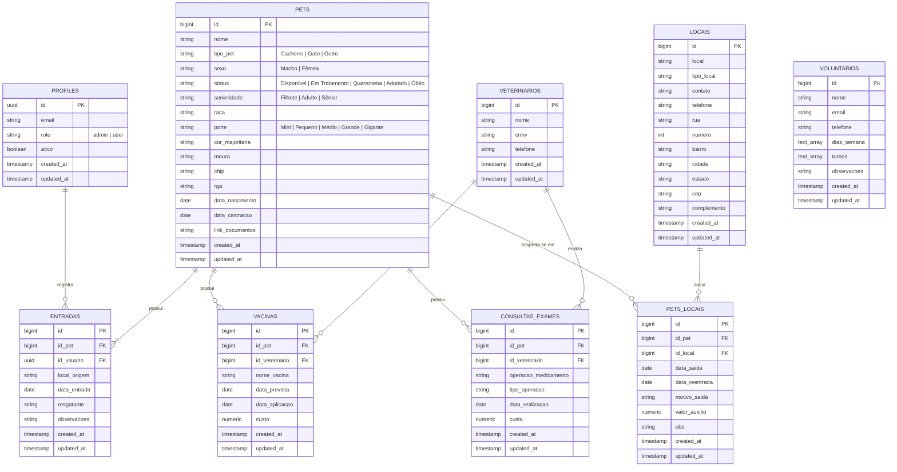

# Documento de Elicitação e Especificação de Requisitos de Software
## Sistema de Gestão para ONGs e Abrigos de Proteção Animal (*Peludinhos do Vale*)

---

**Instituição:** Universidade Feevale  
**Curso:** Engenharia da Computação  
**Trabalho de Conclusão de Curso (TCC)**  
**Projeto:** DESENVOLVIMENTO E VALIDAÇÃO DE SOFTWARE DE GERENCIAMENTO DE DADOS CADASTRAIS DE ANIMAIS DE ONGS DE ACOLHIMENTO E TRATAMENTO DE ANIMAIS DE RUA  
**Versão:** 1.0.0  
**Data:** Outubro de 2026  

---

## 1. Contextualização e Metodologia de Elicitação

### 1.1 Justificativa e Problema de Pesquisa
Organizações Não Governamentais (ONGs) e protetores independentes de animais enfrentam desafios operacionais severos no controle de animais acolhidos, histórico clínico de vacinas e consultas, rotatividade em lares temporários e prestação de contas de despesas veterinárias. A ausência de um sistema informatizado centralizado e responsivo acarreta perda de informações clínicas vitais, retrabalho em triagens de resgate, falhas no controle de vacinação preventiva e falta de rastreabilidade de custos operacionais.

### 1.2 Objetivo do Sistema
Desenvolver uma aplicação web progressiva, responsiva, moderna e resiliente para automatizar e centralizar o fluxo ponta a ponta de acolhimento de animais resgatados: desde o registro de entrada com identificação única, cálculo automatizado de fase de vida, prontuário clínico financeiro detalhado, até o controle de estadias em lares temporários/clínicas e administração de usuários com controle de acesso baseado em funções (RBAC).

### 1.3 Metodologia de Engenharia de Requisitos Aplicada
O processo metodológico de Engenharia de Requisitos adotado no presente TCC baseou-se em uma abordagem iterativa e orientada a prototipação rápida, fundamentada nas seguintes técnicas:

1. **Engenharia Reversa e Análise de Domínio:** Extração e formalização das regras de negócio implícitas em fluxos reais de resgate e nos artefatos arquiteturais implementados.
2. **Mapeamento de Stakeholders e Personas:** Identificação das necessidades de operadores de campo, gestores administrativos e voluntários.
3. **Priorização MoSCoW:** Classificação rigorosa dos requisitos entre *Must have* (Essencial), *Should have* (Importante), *Could have* (Desejável) e *Won't have* (Futuro).
4. **Matriz de Rastreabilidade de Requisitos (RTM):** Garantia de alinhamento bidirecional entre objetivos, requisitos funcionais, regras de negócio e componentes da arquitetura.

---

## 2. Atores do Sistema e Matriz de Permissões (RBAC)

| Ator / Papel | Descrição | Escopo de Permissões |
| :--- | :--- | :--- |
| **Administrador (`admin`)** | Gestor responsável pela governança da ONG e administração do sistema. | Acesso irrestrito a todos os módulos, convite de novos usuários, alteração de níveis de acesso (`role`), ativação/desativação de contas, gestão do quadro de voluntários e escalas, retificação de dados de entrada/resgate do pet e auditoria global. |
| **Operador (`user`)** | Voluntário, médico veterinário parceiro ou colaborador operacional da ONG. | Cadastro e edição cadastral de pets (com dados de entrada em modo somente-leitura), registro de entradas iniciais no cadastro, prontuários clínicos (vacinas/consultas), gestão de lares temporários e parceiros veterinários. Bloqueado nas rotas `/usuarios` e `/voluntarios` via `adminGuard` e políticas RLS. |
| **Sistema / Backend (Supabase + Edge Functions)** | Processamento assíncrono de segurança e integridade referencial. | Aplicação síncrona de banimentos no `auth.users`, disparo de e-mails transacionais (convite/redefinição de senha) e auditoria de timestamps (`created_at`, `updated_at`). |

---

## 3. Requisitos Funcionais (RF)

### Módulo 1: Autenticação, Controle de Acesso e Gestão de Usuários

* **[RF01] Autenticação por E-mail e Senha e Gestão de Sessão**
  * **Descrição:** O sistema deve autenticar usuários cadastrados através de e-mail e senha com persistência segura de token JWT, gerenciando limites rígidos de inatividade (8h) e duração máxima de sessão (24h) com encerramento automático e aviso amigável.
  * **Prioridade:** Must Have (Essencial)
  * **Regras Associadas:** RN01, RN02, RN04

* **[RF02] Redefinição, Primeiro Acesso e Alteração de Senha com Política de Senhas Fortes**
  * **Descrição:** O sistema deve permitir que o usuário defina ou altere sua senha (primeiro acesso de convite, recuperação de credencial ou alteração direta no perfil de usuário), aplicando validação estrita de complexidade e checklist visual reativo em tempo real.
  * **Prioridade:** Must Have (Essencial)
  * **Regras Associadas:** RN03, RN04

* **[RF03] Convite de Novos Usuários por Administrador**
  * **Descrição:** O administrador deve poder convidar novos membros via e-mail, definindo previamente seu perfil de permissão (`admin` ou `user`).
  * **Prioridade:** Must Have (Essencial)
  * **Regras Associadas:** RN01, RN05

* **[RF04] Gestão de Status de Usuários (Ativação / Desativação Lógica e Auth Ban)**
  * **Descrição:** O administrador deve poder desativar ou reativar contas de usuários sem exclusão física dos dados históricos gerados por eles.
  * **Prioridade:** Must Have (Essencial)
  * **Regras Associadas:** RN05, RN06

* **[RF05] Auto-Desativação de Conta**
  * **Descrição:** O próprio usuário autenticado pode solicitar a desativação da sua conta, encerrando sua sessão imediatamente.
  * **Prioridade:** Should Have (Importante)
  * **Regras Associadas:** RN06

* **[RF06] Alternância de Papel de Usuário (`Role Promotion/Demotion`)**
  * **Descrição:** Administradores podem promover operadores a administradores ou rebaixar administradores a operadores.
  * **Prioridade:** Must Have (Essencial)
  * **Regras Associadas:** RN01, RN05

---

### Módulo 2: Gestão Cadastral e Triagem de Pets

* **[RF07] Cadastro Completo de Animal Resgatado e Enquadramento de Foto**
  * **Descrição:** O sistema deve permitir o cadastro de animais acolhidos contendo: Nome, Foto de Perfil com ferramenta interativa de enquadramento (ajuste de zoom, posicionamento e rotação via Canvas antes do upload para o Supabase Storage), Tipo de Espécie (Cachorro, Gato, Outro), Sexo (Macho, Fêmea), Raça, Porte (Mini, Pequeno, Médio, Grande, Gigante), Cor Majoritária, Status (Disponível, Em Tratamento, Quarentena, Adotado, Óbito), Marcadores de Identificação (Moura, Microchip, RGA), Datas (Nascimento aproximada/exata, Castração) e Link de Documentos externos (ex: exames no Google Drive).
  * **Prioridade:** Must Have (Essencial)
  * **Regras Associadas:** RN07, RN08, RN09, RN10, RN20

* **[RF08] Registro Mandatório de Entrada / Histórico de Resgate**
  * **Descrição:** No momento do cadastro do pet, o sistema deve obrigatoriamente registrar os dados da entrada: Local de Origem/Resgate, Data de Entrada, Nome do Resgatante, Observações da Triagem e identificador do usuário logado.
  * **Prioridade:** Must Have (Essencial)
  * **Regras Associadas:** RN10, RN17

* **[RF09] Cálculo Automatizado de Senioridade / Fase de Vida**
  * **Descrição:** Ao informar a data de nascimento do animal, o sistema deve computar e atualizar automaticamente sua classificação etária: *Filhote* (< 12 meses), *Adulto* (1 a < 7 anos) ou *Sênior* (>= 7 anos).
  * **Prioridade:** Must Have (Essencial)
  * **Regras Associadas:** RN09

* **[RF10] Edição Cadastral do Pet, Enquadramento e Dados de Entrada**
  * **Descrição:** Permitir a edição e retificação dos dados cadastrais do animal a qualquer momento por usuários autorizados, incluindo alteração, reajuste de enquadramento (crop/zoom) ou remoção da foto de perfil. Caso o usuário autenticado possua perfil de **Administrador (`admin`)**, o sistema deve permitir adicionalmente a atualização (PUT/UPDATE) dos dados da entrada inicial (local de origem, data de entrada, resgatante e observações).
  * **Prioridade:** Must Have (Essencial)
  * **Regras Associadas:** RN07, RN10, RN17, RN20

* **[RF11] Listagem Filtrada e Busca Multicritério de Pets**
  * **Descrição:** O sistema deve prover listagem em cards visuais e tabela responsiva com filtros simultâneos por: Nome (busca textual com debounce e ignore case), Espécie/Tipo, Sexo, Status Operacional, Senioridade e Porte. Por padrão operacional, a tela inicial de listagem é carregada filtrando automaticamente os animais com Status 'Disponível', permitindo ao usuário alternar para outros status específicos ou selecionar a opção 'Todos'. Em visualizações móveis e tablets (< 992px), os cards de animais adotam padrão ergonômico com botão principal "Ver Detalhes" em destaque (`flex-grow-1`) e menu de ações contextual (ícone de três pontinhos `more_vert` via `MatMenu`), consolidando com segurança as ações elegíveis (Registrar Adoção para pets 'Disponíveis', Editar Cadastro e Prontuário/Docs externo) e impedindo quebras de layout ou transbordamento horizontal em telas compactas (360px a 576px) e grades de duas colunas (`col-sm-6`).
  * **Prioridade:** Must Have (Essencial)
  * **Regras Associadas:** RN07, RN08

* **[RF12] Prontuário Consolidado e Visualização de Detalhes do Pet com Expansão de Foto**
  * **Descrição:** Exibição detalhada contendo visão geral do animal com avatar interativo permitindo ampliação e visualização em alta resolução da foto cadastrada (lightbox/modal), dias de permanência na ONG (calculados a partir da data de resgate), total financeiro acumulado investido no animal e abas para histórico clínico e estadias.
  * **Prioridade:** Must Have (Essencial)
  * **Regras Associadas:** RN11, RN15, RN20

* **[RF28] Exportação e Emissão de Relatórios Gerenciais de Pets (Excel e PDF)**
  * **Descrição:** O sistema deve permitir a exportação dinâmica dos dados dos animais cadastrados para planilha Excel (`.csv` com codificação UTF-8 BOM e delimitador compatível) e a geração de documento para impressão/salvamento em PDF formatado institucionalmente, considerando fielmente todos os filtros aplicados na tela (busca dinâmica, espécie, sexo, status, porte e fase da vida) e incluindo resumo estatístico e indicadores quantitativos.
  * **Prioridade:** Should Have (Importante)
  * **Regras Associadas:** RN07, RN08

---

### Módulo 3: Prontuário Clínico (Vacinas e Procedimentos/Consultas)

* **[RF13] Registro e Acompanhamento de Vacinação**
  * **Descrição:** Cadastro de vacinas contendo: Nome da Vacina (com sugestões pré-configuradas: V8, V10, DHPPI, Antirrábica, Giárdiase, Tosse dos Canis, Leishmaniose, V3, V4, V5), Data Prevista, Data de Efetiva Aplicação, Custo Financeiro e Médico Veterinário Responsável.
  * **Prioridade:** Must Have (Essencial)
  * **Regras Associadas:** RN11, RN12, RN14

* **[RF14] Registro de Consultas, Exames e Procedimentos Cirúrgicos**
  * **Descrição:** Cadastro de atendimentos contendo: Tipo de Operação (Consulta de Rotina, Emergencial, Exame de Sangue, Exame de Imagem, Cirurgia, Medicamento, Outro), Descrição da Operação/Medicamento, Data de Realização, Custo Financeiro e Veterinário Responsável.
  * **Prioridade:** Must Have (Essencial)
  * **Regras Associadas:** RN11, RN13, RN14

* **[RF15] Ordenação Dinâmica do Histórico Clínico**
  * **Descrição:** O prontuário deve permitir alternar a ordenação dos registros clínicos entre "Cronológica" (mais recentes primeiro) e "Por Valor/Custo" (maior investimento primeiro).
  * **Prioridade:** Should Have (Importante)
  * **Regras Associadas:** RN11

* **[RF16] Edição e Exclusão de Registros Clínicos**
  * **Descrição:** Permitir atualizar dados de vacinas e consultas ou removê-los com diálogo de confirmação.
  * **Prioridade:** Must Have (Essencial)
  * **Regras Associadas:** RN17

---

### Módulo 4: Gestão de Locais, Lares Temporários e Acomodação de Pets

* **[RF17] Cadastro e Gestão de Locais Parceiros**
  * **Descrição:** Cadastro de pontos de acolhimento: Nome do Local, Tipo de Local (Lar Temporário, Clínica Veterinária, Feira/Exposição, Abrigo/Canil, CCZ, Outro), Responsável/Contato, Telefone/WhatsApp, Endereço Completo (Rua, Número, Bairro, Cidade, Estado, CEP, Complemento).
  * **Prioridade:** Must Have (Essencial)
  * **Regras Associadas:** RN16

* **[RF18] Listagem e Busca Parametrizada de Locais**
  * **Descrição:** Busca flexível de locais filtrando por campo selecionável: Nome, Tipo, Contato, Telefone, Bairro ou Cidade.
  * **Prioridade:** Must Have (Essencial)
  * **Regras Associadas:** RN16

* **[RF19] Registro de Movimentação e Histórico de Hospedagem do Pet (`pets_locais`)**
  * **Descrição:** Registro do vínculo do animal a um local parceiro, armazenando: Local de Destino, Data de Saída (transferência para o local), Data de Reentrada/Retorno (opcional), Motivo da Transferência, Valor de Auxílio/Custo de Hospedagem e Observações.
  * **Prioridade:** Must Have (Essencial)
  * **Regras Associadas:** RN15, RN16

---

### Módulo 5: Gestão de Médicos Veterinários e Clínicas

* **[RF20] Cadastro de Médicos Veterinários**
  * **Descrição:** Registro de profissionais parceiros contendo: Nome Completo, Número de Registro no Conselho Regional de Medicina Veterinária (CRMV) e Telefone/WhatsApp.
  * **Prioridade:** Must Have (Essencial)
  * **Regras Associadas:** RN14

* **[RF21] Listagem e Filtro de Veterinários**
  * **Descrição:** Busca rápida por Nome, CRMV ou Telefone/WhatsApp.
  * **Prioridade:** Must Have (Essencial)
  * **Regras Associadas:** RN14

---

### Módulo 6: Auditoria, Gestão Financeira e Experiência do Usuário

* **[RF22] Totalizador Financeiro por Animal**
  * **Descrição:** Somatório em tempo real no prontuário do pet calculando: Total Gasto em Vacinas + Total Gasto em Consultas/Procedimentos + Total Gasto em Auxílio de Hospedagem = Custo Total Investido.
  * **Prioridade:** Must Have (Essencial)
  * **Regras Associadas:** RN11, RN15

* **[RF23] Alternância de Tema Visual (Light / Dark / Auto)**
  * **Descrição:** O sistema deve suportar modo claro, modo escuro e sincronização com preferência do sistema operacional, persistindo a escolha localmente.
  * **Prioridade:** Could Have (Desejável)
  * **Regras Associadas:** RNF01, RNF07

* **[RF24] Navegação Inteligente com Histórico de Retorno**
  * **Descrição:** O sistema deve preservar a rota anterior do usuário ao navegar para formulários de criação/edição e retornar para a tela de origem após a conclusão da ação.
  * **Prioridade:** Should Have (Importante)
  * **Regras Associadas:** RNF01

---

### Módulo 7: Gestão de Voluntários e Escalas de Apoio (Apenas Administradores)

* **[RF25] Cadastro Completo de Voluntários com Disponibilidade**
  * **Descrição:** O sistema deve permitir o registro de colaboradores voluntários da ONG contendo: Nome Completo (obrigatório, máx. 50 caracteres), Telefone com DDD (obrigatório), E-mail de Contato (opcional), Dias da Semana Disponíveis (múltipla seleção: Segunda a Domingo), Turnos Disponíveis (múltipla seleção: Manhã, Tarde, Noite) e Observações/Preferências de atividades (máx. 500 caracteres).
  * **Prioridade:** Must Have (Essencial)
  * **Regras Associadas:** RN19, RN17

* **[RF26] Listagem e Consulta de Disponibilidade por Dias e Turnos**
  * **Descrição:** A interface administrativa deve prover busca textual por Nome, Telefone ou E-mail, além de filtros combinados por Dia da Semana e Turno, facilitando a montagem rápida de escalas de resgate, feiras de adoção e cuidados operacionais.
  * **Prioridade:** Must Have (Essencial)
  * **Regras Associadas:** RN19

* **[RF27] Edição e Remoção de Voluntários**
  * **Descrição:** Permitir a atualização dos dados cadastrais e de disponibilidade do voluntário, bem como sua exclusão do quadro mediante diálogo de confirmação.
  * **Prioridade:** Must Have (Essencial)
  * **Regras Associadas:** RN19, RN17

* **[RF29] Fluxo de Adoção Definitiva e Transferência Atômica do Pet**
  * **Descrição:** O sistema deve prover fluxo ágil de adoção definitiva para animais com status operacional 'Disponível', acionado diretamente do prontuário ou da listagem geral de pets via modal padronizada (`AdotarPetDialogComponent`). A operação deve invocar a stored procedure atômica `adotar_pet` no Supabase, alterando simultaneamente o status do animal para 'Adotado' e inserindo o registro da estadia definitiva na tabela `pets_locais` (vinculando adotante/local parceiro, data de saída, motivo 'Adoção Definitiva', observações do termo assinado e auxílio financeiro opcional).
  * **Prioridade:** Must Have (Essencial)
  * **Regras Associadas:** RN08, RN15, RN16, RN21

* **[RF30] Calendário Vacinal Interativo e Gestão de Protocolos de Imunização**
  * **Descrição:** O sistema deve disponibilizar um módulo interativo de Calendário Vacinal (`/calendario-vacinal`) construído com arquitetura nativa em Angular Signals, permitindo a visualização consolidada de todas as doses vacinais previstas para os animais sob tutela da ONG. O calendário adota navegação focada exclusivamente no Mês selecionado (controles de mês anterior, mês atual e próximo mês, evitando sobrecarga cognitiva de múltiplos seletores de período e filtros redundantes), provendo visualizações em Grade Mensal (com células destacadas para hoje, doses do dia e badges coloridas) e Lista/Agenda cronológica do mês, além de suporte a filtro contextual por animal específico via query param (`?petId=X`). Ao clicar em qualquer vacina da grade ou da lista, o sistema abre a modal padronizada `VacinaDialogComponent`, possibilitando a rápida confirmação de aplicação da dose (ação "Aplicar Hoje" com atribuição imediata de data), alteração de data prevista/custo ou exclusão. Uma vez registrada a aplicação, o item adquire instantaneamente uma badge verde de "Aplicada". O calendário também é acessível de forma contextual diretamente a partir da aba de vacinas do prontuário do animal (`pet-detail`).
  * **Prioridade:** Must Have (Essencial)
  * **Regras Associadas:** RN11, RN12, RN14, RN22

---

## 4. Regras de Negócio (RN)

* **[RN01] Restrição de Gestão de Usuários por Papel (RBAC):**  
  Apenas usuários autenticados com a role `admin` podem visualizar a tela de gestão de usuários, enviar convites de acesso e alterar papéis. Operadores comuns (`user`) que tentarem acessar a rota `/usuarios` devem ser barrados por `adminGuard` e redirecionados.

* **[RN02] Controle de Sessão, Timeouts de Inatividade e Sessão Expirada:**  
  Todas as rotas da aplicação (exceto `/login` e `/definir-senha`) são protegidas por `authGuard`. Tentativas de acesso não autenticadas resultam em redirecionamento para `/login`. O Supabase Auth implementa limites rígidos de ciclo de vida de sessão:
  - **Duração Máxima da Sessão (Timebox):** 24 horas.
  - **Inatividade Máxima (Inactivity Timeout):** 8 horas.
  - **Escuta Reativa do Ciclo de Vida:** O `AuthService` escuta os eventos `onAuthStateChange` (`SIGNED_OUT` ou `TOKEN_REFRESHED` com sessão nula). Caso o tempo limite de inatividade expire ou a renovação do token falhe, o usuário é redirecionado automaticamente para `/login` e um toast informativo exibe: *"Sua sessão expirou por inatividade. Por favor, faça login novamente."*.

* **[RN03] Fluxo Fechado de Inscrição, Primeiro Acesso e Proteção na Troca de Senha:**  
  - **Auto-Cadastro Desativado (Signup Fechado):** O endpoint público de auto-registro (`auth.signUp`) é desativado (`signup_disabled`). Não há link nem tela pública de cadastro/inscrição no sistema.
  - **Inclusão Exclusiva por Administradores:** Novos voluntários são incluídos exclusivamente por administradores (`admin`) através da Edge Function `invite-user`.
  - **Primeiro Acesso / Redefinição:** O voluntário convidado recebe link temporário por e-mail com token na URL hash e é direcionado para a rota `/definir-senha`, onde cadastra sua senha pela primeira vez cumprindo a política de senha forte.
  - **Proteção na Troca de Senha (`secure_password_change: true`):** O Supabase Auth exige reautenticação recente para alteração de credencial pelo próprio usuário. Caso a sessão seja antiga, a operação é bloqueada e o frontend orienta o usuário a reautenticar-se antes de definir a nova senha.

* **[RN04] Política de Senhas Fortes e Validação de Credenciais:**  
  O backend do Supabase Auth rejeita nativamente senhas fracas retornando HTTP 422 (`weak_password`), assim como rejeita tentativas de redefinição para a mesma senha atual do usuário (HTTP 422 - `same_password`: *"New password should be different from the old password."*). O frontend Angular trata ambas as situações:
  - **Tratamento de Senha Idêntica (`same_password`):** Mapeado no `AuthService` e nos formulários reativos via erro `samePassword`, exibindo a mensagem explicativa: *"A nova senha deve ser diferente da senha anterior."*.
  - **Validação de Complexidade:** Aplica validação síncrona reativa nos formulários (`strongPasswordValidator` e `SENHA_FORTE_REGEX`) acompanhada de checklist visual com indicadores dinâmicos em tempo real nas telas de Definição de Senha de Convite, Redefinição de Senha e Alteração de Senha no Perfil:
    - **Comprimento Mínimo:** 8 caracteres.
    - **Letra Maiúscula:** ao menos uma (A-Z).
    - **Letra Minúscula:** ao menos uma (a-z).
    - **Número:** ao menos um (0-9).
    - **Símbolo / Caractere Especial:** ao menos um (`!@#$%^&*()_+-=[]{};':"|,.<>/?~`).
    - **Expressão Regular Estrita:** `/^(?=.*[a-z])(?=.*[A-Z])(?=.*\d)(?=.*[!@#$%^&*()_+\-=\[\]{};':"\\|,.<>\/?~`]).{8,}$/`.
  - O e-mail deve obedecer à sintaxe RFC 5322 e ter comprimento máximo de 100 caracteres.

* **[RN05] Preservação de Integridade Referencial em Desativações (Soft Delete):**  
  Nenhum usuário é deletado fisicamente do banco de dados relacional (`hard delete`). Ao desativar um usuário, o campo `ativo` é alterado para `false` no perfil e o Supabase Auth aplica um banimento temporal (`banned_until`), impedindo novos logins sem comprometer o histórico de registros (como quem cadastrou cada pet na tabela `entradas`).

* **[RN06] Regra de Auto-Desativação com Encerramento de Sessão:**  
  Quando um usuário solicita a auto-desativação de sua própria conta, a operação na Edge Function atualiza o status para inativo e, em caso de sucesso, o cliente executa o logout imediatamente, invalidando a sessão no navegador.

* **[RN07] Domínio dos Enums de Classificação do Pet:**  
  Os dados categóricos do pet devem respeitar estritamente as listas controladas:
  * **Espécie:** `Cachorro`, `Gato`, `Outro`
  * **Sexo:** `Macho`, `Fêmea`
  * **Status:** `Disponível`, `Em Tratamento`, `Quarentena`, `Adotado`, `Óbito`
  * **Porte:** `Mini`, `Pequeno`, `Médio`, `Grande`, `Gigante`
  * **Senioridade:** `Filhote`, `Adulto`, `Sênior`

* **[RN08] Busca Tolerante e Normalização de Textos:**  
  A busca de animais deve desconsiderar diferenças entre maiúsculas e minúsculas (`case-insensitive` via operador ILIKE do PostgreSQL/Supabase) e aplicar sanitização (remoção de espaços excedentes nas extremidades).

* **[RN09] Algoritmo Determinístico de Cálculo de Senioridade:**  
  A senioridade do animal é calculada pela diferença em meses e anos entre a data atual e a data de nascimento:
  $$\text{Idade} < 12 \text{ meses} \implies \text{Filhote}$$
  $$1 \text{ ano} \le \text{Idade} < 7 \text{ anos} \implies \text{Adulto}$$
  $$\text{Idade} \ge 7 \text{ anos} \implies \text{Sênior}$$

* **[RN10] Governança, Atomicidade Transacional e Edição de Dados de Entrada / Histórico de Resgate (RBAC):**  
  Ao criar um novo pet, é mandatório registrar a primeira entrada (`local_origem`, `data_entrada`, `resgatante` e `id_usuario` logado). Essa operação é executada de forma estritamente atômica (transação ACID no PostgreSQL) por meio da *Stored Procedure* `create_pet_com_entrada`, garantindo rollback automático caso ocorra qualquer inconsistência e associando automaticamente o `id_usuario` a partir da sessão ativa (`auth.uid()`). Em caso de edição cadastral posterior do animal, a alteração conjunta é processada pela procedure `update_pet_com_entrada`, sendo a retificação dos dados de entrada (`local_origem`, `data_entrada`, `resgatante`, `observacoes`) restrita exclusivamente a usuários autenticados com papel de **Administrador (`admin`)**. Usuários operadores (`user`) visualizam esses campos em modo somente-leitura (`readonly`), prevenindo adulterações acidentais ou não autorizadas no registro histórico inicial do resgate.

* **[RN11] Totalização Financeira e Não-Negatividade de Custos:**  
  Valores de custo de vacinas, procedimentos clínicos e auxílios de hospedagem não podem ser negativos. O cálculo do total investido deve tratar valores nulos como zero ($0.00$) e refletir reativamente a soma no prontuário.

* **[RN12] Gestão de Status de Aplicação Vacinal:**  
  Uma vacina cadastrada possui data prevista obrigatória. Caso a `data_aplicacao` seja preenchida, considera-se a dose efetivada; caso contrário, consta como pendência vacinal no prontuário.

* **[RN13] Categorização Padronizada de Procedimentos:**  
  Todo procedimento médico deve ser classificado em uma das categorias permitidas: `Consulta de Rotina`, `Consulta Emergencial`, `Exame de Sangue`, `Exame de Imagem`, `Procedimento Cirúrgico`, `Medicamento` ou `Outro`.

* **[RN14] Desacoplamento Opcional do Profissional Veterinário:**  
  O vínculo de um médico veterinário a uma vacina ou procedimento clínico é opcional (campo anulável `id_veterinario`), permitindo registros de procedimentos realizados em mutirões ou quando o profissional não está previamente cadastrado na base.

* **[RN15] Rastreabilidade de Estadias e Transparência de Custos:**  
  O histórico de acomodação de um pet em lares temporários armazena o histórico sequencial das datas de entrada e eventual saída/reentrada, permitindo auditar onde o animal esteve alojado ao longo de todo o período sob a tutela da ONG.

* **[RN16] Padronização de Endereçamento de Locais:**  
  Todo local parceiro deve possuir endereço estruturado (logradouro, número, bairro, cidade, estado e CEP) para facilitar a logística de transporte e visitas de inspeção do bem-estar animal.

* **[RN17] Auditoria Automática de Criação e Modificação (`Audit Trail`):**  
  Todas as entidades do banco de dados relacional implementam os atributos de auditoria `created_at` e `updated_at`, gerados e atualizados pelo banco de dados para garantir integridade temporal em conformidade com boas práticas de governança de dados.

* **[RN18] Feedback e Não-Bloqueio de Experiência:**  
  Toda operação assíncrona com o banco de dados deve fornecer feedback visual imediato ao usuário (spinners de carregamento e notificações do tipo *Toast* com estados de sucesso, alerta ou erro claro em língua portuguesa).

* **[RN19] Acesso Exclusivo e Governança do Quadro de Voluntários (RBAC):**  
  Apenas usuários autenticados com o papel de Administrador (`admin`) possuem permissão para acessar a rota `/voluntarios`, visualizar a lista de contatos, consultar disponibilidades por dia/turno e realizar o cadastro, alteração ou exclusão de voluntários. O acesso direto ao banco de dados PostgreSQL é protegido por políticas de Row Level Security (RLS) baseadas na função `public.is_admin()`, e no frontend o acesso à rota é bloqueado por `adminGuard`.

* **[RN20] Armazenamento Seguro, Enquadramento Pré-Upload e Exibição de Fotos (Supabase Storage):**  
  O armazenamento de fotos dos animais é gerenciado em bucket privado (`pets`) no Supabase Storage:
  - **Controle de Acesso e Privacidade:** O bucket é estritamente privado (`public = false`), não permitindo URLs públicas estáticas. O acesso às imagens no frontend é realizado mediante geração de URLs temporárias assinadas (`createSignedUrl`) com tempo de expiração determinado (1 hora / 3600s).
  - **Enquadramento Circular e Compressão Pré-Upload (Canvas):** Ao selecionar uma nova foto no formulário de cadastro/edição, o sistema abre automaticamente modal interativo (`ImageCropperDialogComponent`) com molde exclusivo de avatar circular, provendo controles de zoom (slider, botões +/- e roda do mouse), deslocamento panorâmico (mouse drag ou touch mobile) e rotação em 90°. Ao confirmar o enquadramento, um Canvas desacoplado recorta e converte a área circular selecionada para WebP (600x600 px) com compressão dinâmica progressiva e redução dimensional caso necessário (`image-utils.ts`), garantindo de forma autônoma que qualquer foto de smartphone (mesmo de 10 MB+) seja convertida para um arquivo leve estritamente inferior a 256 KB (262.144 bytes).
  - **Visualização Ampliada (Lightbox Modal):** Na tela de detalhes do animal (`/pets/detalhes/:id`), o avatar com foto assinada é clicável e exibe overlay indicativo ao passar o cursor, abrindo modal em alta resolução (`ImagePreviewDialogComponent`) com opções de fechamento e abertura em nova aba do navegador.
  - **Restrição de Carga e Tipos MIME:** Uploads são estritamente limitados ao tamanho máximo de 256 KB (262.144 bytes) — dimensionamento planejado para viabilizar o armazenamento de no mínimo 4.000 fotos dentro da cota gratuita de 1.000 MB do Supabase Storage — e formatos de imagem aceitos: `image/jpeg`, `image/png` e `image/webp`. Validações ocorrem tanto no cliente quanto na política de integridade do bucket no Supabase.
  - **Limpeza Automática de Fotos Substituídas (Economia de Storage):** Na edição ou remoção de fotos de pets existentes, o sistema remove automaticamente a foto anterior do bucket privado no Supabase Storage, prevenindo o acúmulo de arquivos órfãos e maximizando a retenção útil de armazenamento.
  - **Atomicidade Transacional:** A persistência do caminho relativo da foto (`foto_url`) ocorre exclusivamente através das *Stored Procedures* transacionais (`create_pet_com_entrada` e `update_pet_com_entrada`).
  - **Estratégia de Desempenho e Economia de Banda:** A imagem não é renderizada na listagem geral paginada de animais (tabela/cards gerais), sendo carregada e exibida sob demanda exclusivamente na tela de detalhes do animal (`/pets/detalhes/:id`) e no formulário de edição/cadastro.

* **[RN21] Regra de Elegibilidade e Transição Atômica de Adoção Definitiva:**  
  - **Elegibilidade Rígida de Status:** Animais só podem ser submetidos ao fluxo de adoção definitiva se seu status operacional atual for estritamente `'Disponível'`. Caso o animal esteja em status `'Em Tratamento'`, `'Quarentena'`, `'Adotado'` ou `'Óbito'`, tanto o frontend (bloqueando/ocultando as ações) quanto a stored procedure PostgreSQL `adotar_pet` (lançando exceção amigável) impedem a operação.
  - **Atomicidade Transacional:** A transição de status do animal para `'Adotado'` e a inserção do registro de saída na tabela `pets_locais` ocorrem dentro de uma única transação atômica ACID no banco de dados, garantindo que não existam animais adotados sem vínculo com o adotante/local de destino ou passagens de adoção sem a devida atualização do status do pet.
  - **Cadastro Inline de Novo Adotante:** A interface de adoção permite pesquisar adotantes existentes ou invocar o modal de cadastro de novo local/tutor em tempo de execução sem perda dos dados preenchidos no formulário de adoção.

* **[RN22] Regra de Controle de Status e Aplicação Efetiva de Vacinas:**  
  - **Diferenciação Visual e Operacional:** Toda vacina cadastrada possui `data_prevista` mandatória. Vacinas cuja `data_aplicacao` seja nula constam como **Previstas / Pendentes** (se `data_prevista < data_atual`, são computadas e sinalizadas como **Atrasadas** em destaque de alerta). Quando o campo `data_aplicacao` é preenchido, a vacina adquire o status **Aplicada**, sendo visualmente identificada por uma badge verde e ícone de verificação.
  - **Ação Rápida de Aplicação:** A interface do calendário e do prontuário deve disponibilizar mecanismo de aplicação rápida ("Aplicar Hoje"), atribuindo automaticamente a data corrente à `data_aplicacao` e persistindo a alteração no banco de dados.
  - **Atualização Reativa de Calendário:** A confirmação ou desmarcação de aplicação de uma vacina via `VacinaDialogComponent` ou ação rápida deve refletir instantaneamente nas métricas (KPIs de previstas, aplicadas e atrasadas) e nos chips visuais do calendário sem recarga de página.

---

## 5. Requisitos Não-Funcionais (RNF)

| Identificador | Categoria | Descrição do Requisito | Métrica / Critério de Aceitação |
| :--- | :--- | :--- | :--- |
| **[RNF01]** | **Usabilidade & UX** | A interface deve ser projetada segundo os padrões do Google Material Design 3, com layout responsivo para desktops, tablets e smartphones. Os cabeçalhos de tela adotam o componente unificado `PageHeaderComponent`, provendo ícones temáticos, hierarquia tipográfica e alinhamento responsivo de ações em uma única linha flexível. Os indicadores estatísticos (KPIs) de todas as telas de listagem e acompanhamento adotam o componente unificado `StatCardComponent` (`KpiCardComponent`), encapsulando estilização, alinhamento, variantes temáticas e alvos visuais em um único ponto. Os painéis de busca e filtragem das listagens adotam o componente unificado `FilterPanelComponent`, centralizando o alinhamento de grid, estilização de superfície e botões padronizados de submissão e limpeza ("Filtrar" e "Limpar") com projeção de conteúdo para campos específicos. Todos os modais/diálogos do sistema são padronizados através de componente genérico de layout (`DialogLayoutComponent`), unificando comportamento responsivo, cabeçalhos com ícones, scrollbars ergonômicas e alinhamento de ações em um único ponto. | 100% dos componentes adaptáveis em resoluções de 360px a 4K; conformidade com Material Guidelines, cabeçalhos padronizados, KPIs modulares, painéis de filtro unificados e modais padronizados. |
| **[RNF02]** | **Acessibilidade** | A interface deve prover contraste adequado entre texto e fundo, suporte a leitor de telas e rótulos semânticos (`aria-label`, ícones intuitivos). | WCAG 2.1 Nível AA para contraste e navegação por teclado. |
| **[RNF03]** | **Desempenho de Carga e Banco** | O carregamento inicial e transições devem utilizar Lazy Loading no Angular, e as consultas no PostgreSQL devem ser aceleradas por índices GIN trigram, GIN para arrays e B-Tree compostos para eliminar table scans. | FCP < 1.5s, LCP < 2.5s; tempo de execução de queries de prontuário < 1ms via Index Scan (aferido em 0.109ms via EXPLAIN ANALYZE). |
| **[RNF04]** | **Reatividade de Estado** | O gerenciamento de estado do frontend deve utilizar o novo paradigma de **Signals** e **Computed Signals** do Angular 20, evitando renderizações desnecessárias. | Zero subscrições manuais não gerenciadas em componentes principais; reatividade fina de signals. |
| **[RNF05]** | **Segurança & Autenticação** | Todas as requisições autenticadas devem trafegar via HTTPS com Bearer Tokens JWT emitidos pelo Supabase Auth, política estrita de senhas fortes (8+ caracteres, maiúsculas, minúsculas, números e símbolos com rejeição nativa HTTP 422), proteção contra alteração desautorizada (`secure_password_change: true`), gestão de timeouts de sessão (timebox de 24h e inatividade de 8h) e refresh automático. | Criptografia em trânsito (TLS 1.3), validação estrita de credenciais e proteção em tempo real contra máquinas compartilhadas. |
| **[RNF06]** | **Segurança em Nível de Banco (RLS) e Integridade Referencial** | O banco de dados PostgreSQL deve implementar Row Level Security (RLS) protegendo mutações não autorizadas. Tabelas primárias (`pets`, `locais`, `veterinarios`, `entradas`, `profiles`) possuem exclusão física (`DELETE`) bloqueada para prevenção de órfãos e perda de histórico; exclusões são restritas a itens de prontuário/estadias (`vacinas`, `consultas_exames`, `pets_locais`) exclusivas para administradores (`is_admin()`). | Políticas RLS ativas para todas as tabelas do schema público com matriz de DELETE auditada. |
| **[RNF07]** | **Persistência de Preferências** | As preferências visuais do usuário (Tema Claro / Escuro) devem ser persistidas localmente no navegador (`LocalStorage`). | Retenção da preferência visual em novas sessões sem flicker de tela. |
| **[RNF08]** | **Confiabilidade & Tratamento de Erros** | Erros de rede, validação de formulário ou falhas de Edge Function devem ser interceptados por utilitários centralizados e convertidos em mensagens amigáveis em português. | Ausência de stacktraces expostos ao usuário final; toasts informativos. |
| **[RNF09]** | **Arquitetura de Software, Padronização e Testes Automatizados** | O frontend deve adotar arquitetura modular organizada em camadas: `Core` (serviços globais, auth, guards, interceptors), `Features` (módulos de negócio autocontidos), `Layout` e `Shared` (componentes, diretivas, pipes e layouts genéricos reutilizáveis como `PageHeaderComponent`, `StatCardComponent`, `FilterPanelComponent` e `DialogLayoutComponent`). Todo o código-fonte deve aderir à formatação estrita e padronizada via Prettier (`.prettierrc`), validada por script de verificação em esteira (`npm run format:check`), e dispor de suíte de testes unitários automatizados operando sobre o motor Vitest com ambiente simulado JSDOM e geração de relatórios de cobertura (*V8 Code Coverage*) integráveis a esteiras de CI/CD no GitHub Actions. | Separação estrita de responsabilidades, DRY, alto desacoplamento, 100% de conformidade com Prettier e testes automatizados com cobertura reportada em CI/CD. |
| **[RNF10]** | **Compatibilidade Cross-Browser** | O sistema deve funcionar de maneira consistente nos navegadores modernos: Google Chrome, Mozilla Firefox, Microsoft Edge e Apple Safari. | Suporte comprovado nas versões Evergreen dos navegadores. |

---

## 6. Matriz de Rastreabilidade de Requisitos (RTM)

| ID Requisito | Descrição Resumida | Regras de Negócio (RN) | Requisitos Não-Funcionais (RNF) | Entidades / Tabelas do Banco | Componentes / Serviços Frontend |
| :---: | :--- | :---: | :---: | :--- | :--- |
| **RF01** | Autenticação com e-mail/senha | RN01, RN02, RN04 | RNF05, RNF08 | `auth.users`, `profiles` | `AuthService`, `LoginComponent`, `authGuard` |
| **RF02** | Redefinição, primeiro acesso e alteração de senha | RN03, RN04 | RNF05, RNF08 | `auth.users` | `DefinirSenhaComponent`, `AlterarSenhaDialogComponent`, `PasswordRequirementsComponent`, `AuthService` |
| **RF03** | Convite de usuários por admin | RN01, RN05 | RNF05, RNF08 | `profiles`, `auth.users` | `UsuarioDialogComponent`, `AuthService` |
| **RF04** | Desativação/Reativação de contas | RN05, RN06 | RNF05, RNF08 | `profiles`, `Edge Function` | `UsuariosService`, `UsuarioListComponent` |
| **RF05** | Auto-desativação de conta | RN06 | RNF05, RNF08 | `profiles`, `Edge Function` | `MainLayoutComponent`, `UsuariosService` |
| **RF06** | Alteração de Role (RBAC) | RN01, RN05 | RNF05, RNF08 | `profiles` | `UsuariosService`, `UsuarioListComponent` |
| **RF07** | Cadastro completo de pet, foto e enquadramento | RN07, RN08, RN09, RN20 | RNF01, RNF04, RNF08 | `pets`, `Storage ('pets')` | `PetFormComponent`, `ImageCropperDialogComponent`, `PetsService` |
| **RF08** | Registro obrigatório de entrada | RN10, RN17 | RNF08, RNF09 | `entradas` | `PetFormComponent`, `PetsService` |
| **RF09** | Cálculo de senioridade | RN09 | RNF04 | `pets` | `pet.model.ts (calculateSenioridade)` |
| **RF10** | Edição de pet, reajuste de enquadramento e foto | RN07, RN17, RN20 | RNF01, RNF08 | `pets`, `Storage ('pets')` | `PetFormComponent`, `ImageCropperDialogComponent`, `PetsService` |
| **RF11** | Listagem e filtros de pets | RN07, RN08 | RNF01, RNF03, RNF04 | `pets`, `entradas` | `PetListComponent`, `PetsService` |
| **RF12** | Prontuário consolidado e visualização/expansão de foto | RN11, RN15, RN20 | RNF01, RNF04 | `pets`, `vacinas`, `consultas_exames`, `pets_locais`, `Storage ('pets')` | `PetDetailComponent`, `ImagePreviewDialogComponent`, `PetsService` |
| **RF13** | Cadastro/Gestão de vacinas | RN11, RN12, RN14 | RNF01, RNF04 | `vacinas` | `VacinaDialogComponent`, `VacinasService` |
| **RF14** | Procedimentos clínicos e exames | RN11, RN13, RN14 | RNF01, RNF04 | `consultas_exames` | `ProcedimentoFormComponent`, `ConsultasExamesService` |
| **RF15** | Ordenação de prontuário | RN11 | RNF04 | `vacinas`, `consultas_exames` | `PetDetailComponent (Signals)` |
| **RF16** | Edição/Exclusão clínica | RN17 | RNF08 | `vacinas`, `consultas_exames` | `PetDetailComponent`, `ConfirmationDialog` |
| **RF17** | Cadastro de locais parceiros | RN16, RN17 | RNF01, RNF08 | `locais` | `LocalFormComponent`, `LocaisService` |
| **RF18** | Listagem/Busca de locais | RN16 | RNF01, RNF04 | `locais` | `LocalListComponent`, `LocaisService` |
| **RF19** | Histórico de estadias (`pets_locais`)| RN15, RN16 | RNF01, RNF04 | `pets_locais`, `locais` | `PetLocalFormComponent`, `PetsLocaisService` |
| **RF20** | Cadastro de veterinários | RN14, RN17 | RNF01, RNF08 | `veterinarios` | `VeterinarioFormComponent`, `VeterinariosService` |
| **RF21** | Listagem de veterinários | RN14 | RNF01, RNF04 | `veterinarios` | `VeterinarioListComponent`, `VeterinariosService` |
| **RF22** | Totalizador financeiro reativo | RN11, RN15 | RNF04 | `vacinas`, `consultas_exames`, `pets_locais` | `PetDetailComponent (Computed Signals)` |
| **RF23** | Alternância de tema Light/Dark | RNF01, RNF07 | RNF07 | `LocalStorage` | `ThemeService`, `MainLayoutComponent` |
| **RF24** | Navegação inteligente com retorno | RNF01 | RNF01 | Memória de Roteamento | `NavigationService` |
| **RF25** | Cadastro de voluntários e disponibilidades | RN17, RN19 | RNF01, RNF04, RNF08 | `voluntarios` | `VoluntarioDialogComponent`, `VoluntariosService` |
| **RF26** | Listagem e filtros de voluntários | RN19 | RNF01, RNF03, RNF04 | `voluntarios` | `VoluntarioListComponent`, `VoluntariosService` |
| **RF27** | Edição e exclusão de voluntários | RN17, RN19 | RNF01, RNF08 | `voluntarios` | `VoluntarioDialogComponent`, `VoluntarioListComponent` |
| **RF28** | Relatórios gerenciais de pets (Excel/PDF) | RN07, RN08 | RNF01, RNF04, RNF10 | `pets`, `entradas` | `PetReportService`, `PetListComponent` |
| **RF29** | Fluxo de Adoção Definitiva e Transferência Atômica | RN08, RN15, RN16, RN21 | RNF01, RNF04, RNF06, RNF08 | `pets`, `pets_locais`, `RPC ('adotar_pet')` | `AdotarPetDialogComponent`, `PetDetailComponent`, `PetListComponent`, `PetsService` |
| **RF30** | Calendário Vacinal e Gestão de Imunizações | RN11, RN12, RN14, RN22 | RNF01, RNF03, RNF04, RNF08 | `vacinas`, `pets`, `veterinarios` | `CalendarioVacinalComponent`, `VacinaDialogComponent`, `PetDetailComponent`, `VacinasService` |

---

## 7. Modelo Conceitual do Domínio e Dicionário de Entidades

---

## 8. Conclusão Metodológica para o TCC

Este documento consolida a especificação formal de requisitos de software para a plataforma de gestão da ONG *Peludinhos do Vale*. Ele serve simultaneamente como:
1. **Referencial Metodológico do TCC:** Fundamentando a seção de Engenharia de Requisitos, Análise e Modelagem do Trabalho de Conclusão de Curso na Universidade Feevale.
2. **Baseline de Garantia da Qualidade (QA) e Conformidade:** Permitindo a elaboração de planos de testes unitários (Vitest), testes ponta a ponta (E2E com Playwright), análise estática automatizada com tipagem estrita (ESLint com zero `any`) e validação de aceitação pelos usuários finais.
3. **Guia de Evolução e Manutenibilidade:** Assegurando que futuras expansões funcionais (ex: módulos de adoção pública, campanhas de apadrinhamento e integração com meios de pagamento) respeitem a integridade e as regras de negócio consolidadas.
