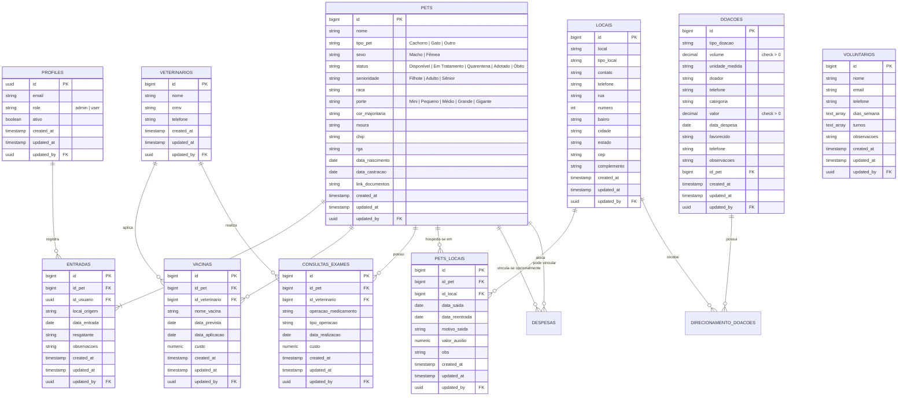

# Documento de Elicitação e Especificação de Requisitos de Software

## Sistema de Gestão para ONGs e Abrigos de Proteção Animal (_Peludinhos do Vale_)

---

**Instituição:** Universidade Feevale  
**Curso:** Engenharia da Computação  
**Trabalho de Conclusão de Curso (TCC)**  
**Projeto:** DESENVOLVIMENTO E VALIDAÇÃO DE SOFTWARE DE GERENCIAMENTO DE DADOS CADASTRAIS DE ANIMAIS DE ONGS DE ACOLHIMENTO E TRATAMENTO DE ANIMAIS DE RUA  
**Versão:** 1.0.0  
**Data:** Outubro de 2026

---

## 1. Contextualização e Metodologia de Elicitação

### 1.1 Justificativa e Problema de Pesquisa

Organizações Não Governamentais (ONGs) e protetores independentes de animais enfrentam desafios operacionais severos no controle de animais acolhidos, histórico clínico de vacinas e consultas, rotatividade em lares temporários e prestação de contas de despesas veterinárias. A ausência de um sistema informatizado centralizado e responsivo acarreta perda de informações clínicas vitais, retrabalho em triagens de resgate, falhas no controle de vacinação preventiva e falta de rastreabilidade de custos operacionais.

### 1.2 Objetivo do Sistema

Desenvolver uma aplicação web progressiva, responsiva, moderna e resiliente para automatizar e centralizar o fluxo ponta a ponta de acolhimento de animais resgatados: desde o registro de entrada com identificação única, cálculo automatizado de fase de vida, prontuário clínico financeiro detalhado, até o controle de estadias em lares temporários/clínicas e administração de usuários com controle de acesso baseado em funções (RBAC).

### 1.3 Metodologia de Engenharia de Requisitos Aplicada

O processo metodológico de Engenharia de Requisitos adotado no presente TCC baseou-se em uma abordagem iterativa e orientada a prototipação rápida, fundamentada nas seguintes técnicas:

1. **Engenharia Reversa e Análise de Domínio:** Extração e formalização das regras de negócio implícitas em fluxos reais de resgate e nos artefatos arquiteturais implementados.
2. **Mapeamento de Stakeholders e Personas:** Identificação das necessidades de operadores de campo, gestores administrativos e voluntários.
3. **Priorização MoSCoW:** Classificação rigorosa dos requisitos entre _Must have_ (Essencial), _Should have_ (Importante), _Could have_ (Desejável) e _Won't have_ (Futuro).
4. **Matriz de Rastreabilidade de Requisitos (RTM):** Garantia de alinhamento bidirecional entre objetivos, requisitos funcionais, regras de negócio e componentes da arquitetura.

---

## 2. Atores do Sistema e Matriz de Permissões (RBAC)

| Ator / Papel                                      | Descrição                                                                  | Escopo de Permissões                                                                                                                                                                                                                                                                                                                                                                                                                                                                                                                                                                                                                        |
| :------------------------------------------------ | :------------------------------------------------------------------------- | :------------------------------------------------------------------------------------------------------------------------------------------------------------------------------------------------------------------------------------------------------------------------------------------------------------------------------------------------------------------------------------------------------------------------------------------------------------------------------------------------------------------------------------------------------------------------------------------------------------------------------------------ |
| **Administrador (`admin`)**                       | Gestor responsável pela governança da ONG e administração do sistema.      | Acesso irrestrito a todos os módulos, gestão do painel financeiro e orçamentário (`/financeiro`), convite de novos usuários, alteração de níveis de acesso (`role`), ativação/desativação de contas, gestão do quadro de voluntários e escalas, retificação de dados de entrada/resgate do pet, auditoria global e **permissão exclusiva para operações de exclusão física em tabelas operacionais de exceção (`vacinas`, `consultas_exames`, `direcionamento_doacoes`, `doacoes_monetarias` e `despesas`)**.                                                                                                                               |
| **Operador (`user`)**                             | Voluntário, médico veterinário parceiro ou colaborador operacional da ONG. | Cadastro e edição cadastral de pets (com dados de entrada em modo somente-leitura), registro de entradas iniciais no cadastro, prontuários clínicos (vacinas/consultas), gestão de lares temporários e parceiros veterinários. Bloqueado nas rotas `/usuarios`, `/voluntarios` e `/financeiro` via `adminGuard` e políticas RLS. **Não possui permissão de exclusão física de registros** (ações de exclusão em `vacinas`, `consultas_exames`, `direcionamento_doacoes`, `doacoes_monetarias` e `despesas` são restritas a administradores tanto na interface com botões desabilitados/ocultos quanto nas políticas RLS do banco de dados). |
| **Sistema / Backend (Supabase + Edge Functions)** | Processamento assíncrono de segurança e integridade referencial.           | Aplicação síncrona de banimentos no `auth.users`, disparo de e-mails transacionais (convite/redefinição de senha) e auditoria de timestamps (`created_at`, `updated_at`).                                                                                                                                                                                                                                                                                                                                                                                                                                                                   |

---

## 3. Requisitos Funcionais (RF)

### Módulo 1: Autenticação, Controle de Acesso e Gestão de Usuários

- **[RF01] Autenticação por E-mail e Senha e Gestão de Sessão**
  - **Descrição:** O sistema deve autenticar usuários cadastrados através de e-mail e senha com persistência segura de token JWT, gerenciando limites rígidos de inatividade (8h) e duração máxima de sessão (24h) com encerramento automático e aviso amigável.
  - **Prioridade:** Must Have (Essencial)
  - **Regras Associadas:** RN01, RN02, RN04

- **[RF02] Redefinição, Primeiro Acesso e Alteração de Senha com Política de Senhas Fortes**
  - **Descrição:** O sistema deve permitir que o usuário defina ou altere sua senha (primeiro acesso de convite, recuperação de credencial ou alteração direta no perfil de usuário), aplicando validação estrita de complexidade e checklist visual reativo em tempo real.
  - **Prioridade:** Must Have (Essencial)
  - **Regras Associadas:** RN03, RN04

- **[RF03] Convite de Novos Usuários por Administrador**
  - **Descrição:** O administrador deve poder convidar novos membros via e-mail, definindo previamente seu perfil de permissão (`admin` ou `user`).
  - **Prioridade:** Must Have (Essencial)
  - **Regras Associadas:** RN01, RN05

- **[RF04] Gestão de Status de Usuários (Ativação / Desativação Lógica e Auth Ban)**
  - **Descrição:** O administrador deve poder desativar ou reativar contas de usuários sem exclusão física dos dados históricos gerados por eles.
  - **Prioridade:** Must Have (Essencial)
  - **Regras Associadas:** RN05, RN06

- **[RF05] Auto-Desativação de Conta**
  - **Descrição:** O próprio usuário autenticado pode solicitar a desativação da sua conta, encerrando sua sessão imediatamente.
  - **Prioridade:** Should Have (Importante)
  - **Regras Associadas:** RN06

- **[RF06] Alternância de Papel de Usuário (`Role Promotion/Demotion`)**
  - **Descrição:** Administradores podem promover operadores a administradores ou rebaixar administradores a operadores.
  - **Prioridade:** Must Have (Essencial)
  - **Regras Associadas:** RN01, RN05

---

### Módulo 2: Gestão Cadastral e Triagem de Pets

- **[RF07] Cadastro Completo de Animal Resgatado e Enquadramento de Foto**
  - **Descrição:** O sistema deve permitir o cadastro de animais acolhidos contendo: Nome, Foto de Perfil com ferramenta interativa de enquadramento (ajuste de zoom, posicionamento e rotação via Canvas antes do upload para o Supabase Storage), Tipo de Espécie (Cachorro, Gato, Outro), Sexo (Macho, Fêmea), Raça, Porte (Mini, Pequeno, Médio, Grande, Gigante), Cor Majoritária, Status (Disponível, Em Tratamento, Quarentena, Adotado, Óbito), Marcadores de Identificação (Moura, Microchip, RGA), Datas (Nascimento aproximada/exata, Castração) e Link de Documentos externos (ex: exames no Google Drive).
  - **Prioridade:** Must Have (Essencial)
  - **Regras Associadas:** RN07, RN08, RN09, RN10, RN20

- **[RF08] Registro Mandatório de Entrada / Histórico de Resgate**
  - **Descrição:** No momento do cadastro do pet, o sistema deve obrigatoriamente registrar os dados da entrada: Local de Origem/Resgate, Data de Entrada, Nome do Resgatante, Observações da Triagem e identificador do usuário logado.
  - **Prioridade:** Must Have (Essencial)
  - **Regras Associadas:** RN10, RN17

- **[RF09] Cálculo Automatizado de Senioridade / Fase de Vida**
  - **Descrição:** Ao informar a data de nascimento do animal, o sistema deve computar e atualizar automaticamente sua classificação etária: _Filhote_ (< 12 meses), _Adulto_ (1 a < 7 anos) ou _Sênior_ (>= 7 anos).
  - **Prioridade:** Must Have (Essencial)
  - **Regras Associadas:** RN09

- **[RF10] Edição Cadastral do Pet, Enquadramento e Dados de Entrada**
  - **Descrição:** Permitir a edição e retificação dos dados cadastrais do animal a qualquer momento por usuários autorizados, incluindo alteração, reajuste de enquadramento (crop/zoom) ou remoção da foto de perfil. Ao acessar a edição a partir da tela de detalhes do animal, a interface reaproveita a foto assinada em cache síncrono (`history.state.fotoUrl` e `PetsService.getCachedSignedFotoUrl`), renderizando o preview instantaneamente sem delay ou requisições desnecessárias. Caso o usuário autenticado possua perfil de **Administrador (`admin`)**, o sistema deve permitir adicionalmente a atualização (PUT/UPDATE) dos dados da entrada inicial (local de origem, data de entrada, resgatante e observações).
  - **Prioridade:** Must Have (Essencial)
  - **Regras Associadas:** RN07, RN10, RN17, RN20

- **[RF11] Listagem Filtrada e Busca Multicritério de Pets**
  - **Descrição:** O sistema deve prover listagem em cards visuais e tabela responsiva com filtros simultâneos por: Nome (busca textual com debounce e ignore case), Espécie/Tipo, Sexo, Status Operacional, Senioridade e Porte. Por padrão operacional, a tela inicial de listagem é carregada filtrando automaticamente os animais com Status 'Disponível', permitindo ao usuário alternar para outros status específicos ou selecionar a opção 'Todos'. Em visualizações móveis e tablets (< 992px), os cards de animais adotam padrão ergonômico com botão principal "Ver Detalhes" em destaque (`flex-grow-1`) e menu de ações contextual (ícone de três pontinhos `more_vert` via `MatMenu`), consolidando com segurança as ações elegíveis (Registrar Adoção para pets 'Disponíveis', Editar Cadastro e Prontuário/Docs externo) e impedindo quebras de layout ou transbordamento horizontal em telas compactas (360px a 576px) e grades de duas colunas (`col-sm-6`).
  - **Prioridade:** Must Have (Essencial)
  - **Regras Associadas:** RN07, RN08

- **[RF12] Prontuário Consolidado e Visualização de Detalhes do Pet com Expansão de Foto**
  - **Descrição:** Exibição detalhada contendo visão geral do animal com avatar interativo permitindo ampliação e visualização em alta resolução da foto cadastrada (lightbox/modal), dias de permanência na ONG (calculados a partir da data de resgate), total financeiro acumulado investido no animal e abas para histórico clínico e estadias.
  - **Prioridade:** Must Have (Essencial)
  - **Regras Associadas:** RN11, RN15, RN20

---

### Módulo 3: Prontuário Clínico (Vacinas e Procedimentos/Consultas)

- **[RF13] Registro e Acompanhamento de Vacinação**
  - **Descrição:** Cadastro de vacinas contendo: Nome da Vacina (com sugestões pré-configuradas: V8, V10, DHPPI, Antirrábica, Giárdiase, Tosse dos Canis, Leishmaniose, V3, V4, V5), Data Prevista, Data de Efetiva Aplicação, Custo Financeiro e Médico Veterinário Responsável. A interface disponibiliza atalho de cadastro rápido de novo profissional parceiro sem sair do modal; o novo registro é persistido via mutação atômica, inserido na lista em memória e pré-selecionado automaticamente no formulário, eliminando consultas GET redundantes.
  - **Prioridade:** Must Have (Essencial)
  - **Regras Associadas:** RN11, RN12, RN14

- **[RF14] Registro de Consultas, Exames e Procedimentos Cirúrgicos**
  - **Descrição:** Cadastro de atendimentos contendo: Tipo de Operação (Consulta de Rotina, Emergencial, Exame de Sangue, Exame de Imagem, Cirurgia, Medicamento, Outro), Descrição da Operação/Medicamento, Data de Realização, Custo Financeiro e Veterinário Responsável. Permite cadastro rápido de novo médico veterinário com auto-seleção e zero GETs supérfluos.
  - **Prioridade:** Must Have (Essencial)
  - **Regras Associadas:** RN11, RN13, RN14

- **[RF15] Ordenação Dinâmica do Histórico Clínico**
  - **Descrição:** O prontuário deve permitir alternar a ordenação dos registros clínicos entre "Cronológica" (mais recentes primeiro) e "Por Valor/Custo" (maior investimento primeiro).
  - **Prioridade:** Should Have (Importante)
  - **Regras Associadas:** RN11

- **[RF16] Edição e Exclusão de Registros Clínicos (Vacinas, Consultas e Procedimentos)**
  - **Descrição:** Permitir atualizar dados de vacinas e consultas/exames. A exclusão de registros clínicos (vacinas e procedimentos/consultas/exames) é prerrogativa estrita de usuários com perfil de Administrador (`admin`), exibindo diálogo de confirmação destrutiva (`ConfirmationDialogComponent`) e feedback visual de sucesso/erro. Para usuários com perfil Operador (`user`), as opções de exclusão são desabilitadas na tabela do prontuário ou omitidas nos formulários de edição.
  - **Prioridade:** Must Have (Essencial)
  - **Regras Associadas:** RN17, RN27

---

### Módulo 4: Gestão de Locais, Lares Temporários e Acomodação de Pets

- **[RF17] Cadastro e Gestão de Locais Parceiros**
  - **Descrição:** Cadastro de pontos de acolhimento: Nome do Local, Tipo de Local (Lar Temporário, Clínica Veterinária, Feira/Exposição, Abrigo/Canil, CCZ, Outro), Responsável/Contato, Telefone/WhatsApp, Endereço Completo (Rua, Número, Bairro, Cidade, Estado, CEP, Complemento).
  - **Prioridade:** Must Have (Essencial)
  - **Regras Associadas:** RN16

- **[RF18] Listagem e Busca Parametrizada de Locais**
  - **Descrição:** Busca flexível de locais filtrando por campo selecionável: Nome, Tipo, Contato, Telefone, Bairro ou Cidade.
  - **Prioridade:** Must Have (Essencial)
  - **Regras Associadas:** RN16

- **[RF19] Registro de Movimentação e Histórico de Hospedagem do Pet (`pets_locais`)**
  - **Descrição:** Registro do vínculo do animal a um local parceiro, armazenando: Local de Destino, Data de Saída (transferência para o local), Data de Reentrada/Retorno (opcional), Motivo da Transferência, Valor de Auxílio/Custo de Hospedagem e Observações. Permite cadastro inline de novo ponto de acolhimento com pré-seleção automática e atualização em memória (`locaisSignal`), descartando requisições GET completas após a inserção.
  - **Prioridade:** Must Have (Essencial)
  - **Regras Associadas:** RN15, RN16

---

### Módulo 5: Gestão de Médicos Veterinários e Clínicas

- **[RF20] Cadastro de Médicos Veterinários**
  - **Descrição:** Registro de profissionais parceiros contendo: Nome Completo, Número de Registro no Conselho Regional de Medicina Veterinária (CRMV) e Telefone/WhatsApp.
  - **Prioridade:** Must Have (Essencial)
  - **Regras Associadas:** RN14

- **[RF21] Listagem e Filtro de Veterinários**
  - **Descrição:** Busca rápida por Nome, CRMV ou Telefone/WhatsApp.
  - **Prioridade:** Must Have (Essencial)
  - **Regras Associadas:** RN14

---

### Módulo 6: Auditoria, Gestão Financeira e Experiência do Usuário

- **[RF22] Totalizador Financeiro por Animal e Despesas Vinculadas da ONG**
  - **Descrição:** Somatório em tempo real no prontuário do pet calculando: Total Gasto em Vacinas + Total Gasto em Consultas/Procedimentos + Total Gasto em Auxílio de Hospedagem + Total de Despesas Institucionais Vinculadas da ONG = Custo Total Investido Geral. O prontuário do animal deve exibir um card dedicado (`app-pet-despesas-card`) listando todas as despesas institucionais alocadas àquele animal com descrição, categoria, data, favorecido, valor e ações administrativas (inclusão com ID pré-selecionado, edição e exclusão restrita a administradores), além de refletir a métrica no hero do pet. Ao abrir a modal de cadastro ou edição de despesa no contexto de um animal específico (`DespesaDialogComponent`), o sistema bloqueia o campo de seleção do pet (`id_pet.disable()`) e dispensa a busca geral de listagem de animais (`fetchPets`), eliminando consultas desnecessárias de rede. A consulta das despesas vinculadas implementa cache em memória no `DespesasService` (`petDespesasSignal`), eliminando requisições GET supérfluas na navegação de retorno de telas secundárias (como consultas e exames). As operações de inclusão, edição e exclusão sincronizam o estado local diretamente a partir do objeto retornado pela mutação do Supabase, descartando refetches de rede desnecessários.
  - **Prioridade:** Must Have (Essencial)
  - **Regras Associadas:** RN11, RN15, RN26, RN27

- **[RF23] Alternância de Tema Visual (Light / Dark / Auto)**
  - **Descrição:** O sistema deve suportar modo claro, modo escuro e sincronização com preferência do sistema operacional, persistindo a escolha localmente.
  - **Prioridade:** Could Have (Desejável)
  - **Regras Associadas:** RNF01, RNF07

- **[RF24] Navegação Inteligente com Histórico de Retorno**
  - **Descrição:** O sistema deve preservar a rota anterior do usuário ao navegar para formulários de criação/edição e retornar para a tela de origem após a conclusão da ação.
  - **Prioridade:** Should Have (Importante)
  - **Regras Associadas:** RNF01

---

### Módulo 7: Gestão de Voluntários e Escalas de Apoio (Apenas Administradores)

- **[RF25] Cadastro Completo de Voluntários com Disponibilidade**
  - **Descrição:** O sistema deve permitir o registro de colaboradores voluntários da ONG contendo: Nome Completo (obrigatório, máx. 50 caracteres), Telefone com DDD (obrigatório), E-mail de Contato (opcional), Dias da Semana Disponíveis (múltipla seleção: Segunda a Domingo), Turnos Disponíveis (múltipla seleção: Manhã, Tarde, Noite) e Observações/Preferências de atividades (máx. 500 caracteres).
  - **Prioridade:** Must Have (Essencial)
  - **Regras Associadas:** RN19, RN17

- **[RF26] Listagem e Consulta de Disponibilidade por Dias e Turnos**
  - **Descrição:** A interface administrativa deve prover busca textual por Nome, Telefone ou E-mail, além de filtros combinados por Dia da Semana e Turno, facilitando a montagem rápida de escalas de resgate, feiras de adoção e cuidados operacionais.
  - **Prioridade:** Must Have (Essencial)
  - **Regras Associadas:** RN19

- **[RF27] Edição e Remoção de Voluntários**
  - **Descrição:** Permitir a atualização dos dados cadastrais e de disponibilidade do voluntário, bem como sua exclusão do quadro mediante diálogo de confirmação.
  - **Prioridade:** Must Have (Essencial)
  - **Regras Associadas:** RN19, RN17

- **[RF28] Relatórios Gerenciais de Pets e Ficha Individual do Animal (PDF / Impressão e Excel)**
  - **Descrição:** O sistema deve disponibilizar recursos para emissão e exportação de relatórios tanto em lote quanto individualizados por animal:
    1. **Relatório Gerencial Geral (`/pets`):** Exportação da listagem filtrada para planilha Excel (.csv com UTF-8 BOM e sanitização anti-CSV Injection) e geração de relatório analítico em PDF/impressão com cabeçalho da ONG, KPIs de status e grade de dados.
    2. **Ficha Individual e Prontuário do Animal (`/pets/:id`):** Emissão a partir do cabeçalho de detalhes (`PetDetailHeaderComponent`) com três modalidades:
       - **Ficha de Adoção & Prontuário Clínico (PDF):** Documento oficial para entrega a adotantes e acompanhamento veterinário externo, contendo identificação completa, foto, histórico de vacinas e consultas/procedimentos realizados, omitindo valores financeiros para resguardo de privacidade e incorporando Termo de Guarda Responsável com campos para qualificação e assinaturas físicas do adotante e da ONG.
       - **Ficha Completa com Custos & Prestação de Contas (PDF):** Documento para auditoria interna, prestação de contas com padrinhos e controle administrativo da ONG, incluindo detalhamento financeiro com valores de vacinas, procedimentos, estadias e despesas diretas da instituição.
       - **Exportação da Ficha em Planilha (.csv):** Arquivo tabular estruturado com todos os dados cadastrais e histórico do animal.
  - **Prioridade:** Must Have (Essencial)
  - **Regras Associadas:** RN07, RN08, RN11, RN12, RN13, RN15

- **[RF29] Fluxo de Adoção Definitiva e Transferência Atômica do Pet**
  - **Descrição:** O sistema deve prover fluxo ágil de adoção definitiva para animais com status operacional 'Disponível', acionado diretamente do prontuário ou da listagem geral de pets via modal padronizada (`AdotarPetDialogComponent`). A operação deve invocar a stored procedure atômica `adotar_pet` no Supabase, alterando simultaneamente o status do animal para 'Adotado' e inserindo o registro da estadia definitiva na tabela `pets_locais` (vinculando adotante/local parceiro, data de saída, motivo 'Adoção Definitiva', observações do termo assinado e auxílio financeiro opcional).
  - **Prioridade:** Must Have (Essencial)
  - **Regras Associadas:** RN08, RN15, RN16, RN21

- **[RF30] Calendário Vacinal Interativo e Gestão de Protocolos de Imunização**
  - **Descrição:** O sistema deve disponibilizar um módulo interativo de Calendário Vacinal (`/calendario-vacinal`) construído com arquitetura nativa em Angular Signals, permitindo a visualização consolidada de todas as doses vacinais previstas para os animais sob tutela da ONG. O calendário adota navegação focada exclusivamente no Mês selecionado (controles de mês anterior, mês atual e próximo mês, evitando sobrecarga cognitiva de múltiplos seletores de período e filtros redundantes), provendo visualizações em Grade Mensal (com células destacadas para hoje, doses do dia e badges coloridas) e Lista/Agenda cronológica do mês, além de suporte a filtro contextual por animal específico via query param (`?petId=X`). Ao clicar em qualquer vacina da grade ou da lista, o sistema abre a modal padronizada `VacinaDialogComponent`, possibilitando a rápida confirmação de aplicação da dose (ação "Aplicar Hoje" com atribuição imediata de data), alteração de data prevista/custo ou exclusão. Uma vez registrada a aplicação, o item adquire instantaneamente uma badge verde de "Aplicada". O calendário também é acessível de forma contextual diretamente a partir da aba de vacinas do prontuário do animal (`pet-detail`).
  - **Prioridade:** Must Have (Essencial)
  - **Regras Associadas:** RN11, RN12, RN14, RN22

---

### Módulo 8: Gestão de Doações e Rateio de Insumos (`public.doacoes` e `public.direcionamento_doacoes`)

- **[RF31] Registro e Controle de Doações de Insumos Recebidos**
  - **Descrição:** O sistema deve permitir o cadastro e gerenciamento de doações físicas/materiais recebidas pela ONG (rações, cobertores, medicamentos, insumos de limpeza), armazenando: Tipo de Doação (obrigatório, máx. 50 caracteres, com autocomplete e botões de seleção rápida para: Ração, Medicamento, Material de Limpeza, Cobertores/Camas, Acessórios, Outro), Nome do Doador (pessoa física ou jurídica, obrigatório, máx. 50 caracteres), Telefone de Contato (opcional, com máscara e link direto para WhatsApp), Volume Total Arrecadado (decimal 10,2 positivo) e Unidade de Medida (obrigatório, máx. 10 caracteres, com botões de seleção rápida para: kg, litros, un, sacos, pacotes, caixas, latas, fardos).
  - **Prioridade:** Must Have (Essencial)
  - **Regras Associadas:** RN17, RN23, RN24

- **[RF32] Rateio e Direcionamento de Doações para Locais Parceiros (`direcionamento_doacoes`)**
  - **Descrição:** Permitir a distribuição fracionada ou integral dos insumos de uma doação para os locais de acolhimento cadastrados (`public.locais`), associando o Local de Destino e o Volume Destinado. A interface deve prover validação instantânea para que o volume a direcionar não ultrapasse o saldo livre da doação de origem, oferecendo atalho para alocação do saldo total restante em um clique. A exclusão física ou estorno de direcionamentos de doações é restrita a usuários com perfil de Administrador (`admin`), com botões desabilitados e salvaguarda imperativa para operadores comuns.
  - **Prioridade:** Must Have (Essencial)
  - **Regras Associadas:** RN16, RN23, RN24, RN25, RN27

- **[RF33] Painel Master-Detail e Visão Consolidada de Insumos por Local**
  - **Descrição:** O sistema deve disponibilizar aba própria na navegação principal (`/doacoes`) composta por visões operacionais isoladas através do padrão de composição de abas (_Smart Tabs Composition_ com renderização preguiçosa `matTabContent` e controle reativo de aba ativa): (1) Aba "Doações e Rateio" (`DoacoesInsumosTabComponent`) com listagem mestre de doações, filtros de busca por Doador/Telefone/Unidade, filtro de status de saldo (100% Livre, Parcial, Esgotada), KPIs em tempo real, barra de progresso visual de distribuição e expansão inline (Master-Detail) revelando os locais atendidos com opções de edição de volume e estorno; e (2) Aba "Direcionamentos por Local" (`DoacoesDirecionamentosTabComponent`), apresentando a tabela intermediária consolidada com filtro por local parceiro para auditoria do total de insumos que cada abrigo ou clínica já recebeu da ONG.
  - **Otimização de Requisições HTTP Sob Demanda (Lazy Tab Loading):** As abas do módulo de doações não exibem contadores numéricos estáticos no cabeçalho, eliminando chamadas antecipadas em lote na inicialização da página. Cada subcomponente de aba é responsável exclusivamente por suas próprias consultas HTTP (`fetchDoacoes`, `fetchDoacoesMonetarias` ou `fetchDirecionamentos` e `fetchLocais`), disparando a carga somente quando a respectiva aba for selecionada pelo usuário.
  - **Prioridade:** Must Have (Essencial)
  - **Regras Associadas:** RN23, RN24, RN25

- **[RF34] Registro e Controle Financeiro de Doações Monetárias (`public.doacoes_monetarias`)**
  - **Descrição:** O sistema deve disponibilizar aba dedicada "Doações em Dinheiro" (`DoacoesMonetariasTabComponent`) no módulo de doações (`/doacoes`) para gerenciamento de contribuições financeiras recebidas pela instituição (via PIX, dinheiro ou transferência bancária), armazenando: Valor Doado (decimal 10,2 estritamente positivo, obrigatório), Nome do Doador (obrigatório, máx. 50 caracteres), Telefone de Contato (opcional, com máscara, cópia rápida e link direto para WhatsApp), Data da Doação (date, padrão data corrente) e Observações/Finalidade (opcional, máx. 255 caracteres).
  - **Funcionalidades e Painel:** A interface apresenta KPIs financeiros computados em tempo real (Total Arrecadado, Total de Doações, Média por Doação e Maior Doação recebida), painel de filtros combinados por Doador/Telefone e Período (A partir de / Até), atalhos de valores sugeridos no modal de cadastro (R$ 20, R$ 50, R$ 100, R$ 200, R$ 500) e paginação ergonômica.
  - **Governança e Permissões:** Em conformidade com as políticas de segurança RLS (`is_admin()`), a exclusão de registros de doações monetárias é uma prerrogativa exclusiva de usuários com papel de Administrador (`admin`), prevenindo exclusões indevidas por operadores comuns.
  - **Prioridade:** Must Have (Essencial)
  - **Regras Associadas:** RN01, RN17, RN26

---

### Módulo 9: Painel Financeiro, Balanço Orçamentário e Despesas Gerais (`/financeiro`)

- **[RF35] Painel Financeiro, Balanço Orçamentário e Indicadores de Sustentabilidade (`public.vw_fluxo_caixa`)**
  - **Descrição:** O sistema deve disponibilizar painel administrativo estratégico exclusivo para administradores (`/financeiro`), composto por orquestrador desacoplado (`FinanceiroDashboardComponent`) com abas modulares preguiçosas (`matTabContent`): a aba "Fluxo de Caixa & Indicadores" (`FinanceiroFluxoTabComponent`), consolidando em tempo real todas as entradas financeiras (`public.doacoes_monetarias`), despesas operacionais da instituição (`public.despesas`), custos clínicos assistenciais dos animais resgatados (`public.consultas_exames` e `public.vacinas` com custos positivos) e auxílios de custos pagos para estadias em lares temporários (`public.pets_locais` com `valor_auxilio > 0`) através da view relacional `public.vw_fluxo_caixa`; e a aba "Despesas Institucionais" (`FinanceiroDespesasTabComponent`).
  - **Funcionalidades e Análise:**
    - **Barra Temporal Rápida:** Filtros com 1 clique para Mês Atual, Mês Anterior, Últimos 90 Dias, Ano Vigente e Intervalo Personalizado (Data Inicial / Final).
    - **KPIs Executivos:** Total Arrecadado (Entradas), Total de Despesas (Saídas), Balanço Líquido (Superávit/Déficit com sinalização visual dinâmica) e Taxa de Cobertura Orçamentária (% de despesas cobertas por doações).
    - **Gráfico SVG de Evolução Mensal:** Gráfico cronológico nativo em SVG/CSS comparando barras lado a lado de Entradas (verde) e Saídas (vermelho) mês a mês com tooltips interativos.
    - **Distribuição de Despesas por Categoria:** Barras horizontais dinâmicas com percentuais e valores consolidados por tipo de despesa.
    - **Inteligência de Direcionamento (Top 5 Animais Mais Custosos):** Ranking dos animais que mais demandaram investimento clínico no período com link direto para o prontuário, apoiando campanhas de apadrinhamento.
    - **Lançamentos Detalhados:** Tabela discriminada de todos os registros contábeis do período com paginação.
    - **Otimização de Requisições HTTP por Aba Ativa (Lazy Tab Loading):** O carregamento da tabela de despesas gerais (`public.despesas` via `DespesasService.fetchDespesas`) ocorre estritamente sob demanda. Na inicialização do painel e na alternância de períodos temporais, se o gestor estiver na aba 0 ("Visão Geral & Indicadores"), apenas a consolidação da view `public.vw_fluxo_caixa` é consultada. A requisição HTTP detalhada de despesas é disparada exclusivamente se a aba 1 ("Despesas Gerais da ONG") estiver ativa ou for ativada pelo usuário, contando com cache por período para evitar requisições redundantes.
  - **Prioridade:** Must Have (Essencial)
  - **Regras Associadas:** RN01, RN17, RN28

- **[RF36] Registro e Gestão de Despesas Gerais da Instituição (`public.despesas`)**
  - **Descrição:** Permitir o cadastro, consulta, edição e exclusão de despesas gerais e saídas financeiras institucionais da ONG que não são procedimentos clínicos individuais (ex: sacos de ração em atacado, insumos de limpeza, transporte de resgates, manutenção da sede, despesas operacionais avulsas).
  - **Atributos:** Descrição (obrigatório, 3-100 caracteres), Categoria padronizada (enum com 8 opções: Alimentação / Ração, Medicamentos & Insumos Gerais, Higiene & Limpeza, Transporte & Resgate, Infraestrutura & Sede, Serviços Veterinários Avulsos, Administrativo & Operacional, Outro), Valor (decimal 10,2 positivo), Data do Pagamento/Despesa (date, padrão data corrente), Favorecido/Fornecedor (obrigatório, 2-100 caracteres), Telefone (opcional, com máscara), Vínculo opcional a um animal resgatado (`id_pet`) e Observações (opcional, máx. 255 caracteres).
  - **Visualização Completa de Detalhes:** Modal dedicada (`DespesaDetalhesDialogComponent`) acessível tanto no painel financeiro geral quanto no prontuário do pet, exibindo todos os dados do lançamento (ID, descrição integral sem truncamento, valor destacado, categoria contábil, data, favorecido, telefone formatado, vínculo com animal com atalho de navegação, texto completo de observações e trilha de auditoria com popover de identificação do editor).
  - **Governança de Exclusão:** Exclusão física restrita a administradores (`is_admin()`).
  - **Prioridade:** Must Have (Essencial)
  - **Regras Associadas:** RN17, RN27, RN28

- **[RF37] Prestação de Contas Oficial em PDF e Exportação de Planilha (Excel/CSV)**
  - **Descrição:** O sistema deve permitir a emissão client-side em um clique do Balancete Oficial de Prestação de Contas formatado para impressão ou PDF (contendo cabeçalho institucional da ONG, período auditado, sumário executivo de KPIs, detalhamento de despesas por categoria, extrato discriminado dos lançamentos contábeis e campos para assinaturas da tesouraria e diretoria executiva), bem como a exportação completa dos lançamentos do período para planilha eletrônica (.CSV com UTF-8 BOM e separador compatível com o Microsoft Excel).
  - **Prioridade:** Should Have (Importante)
  - **Regras Associadas:** RN28

---

## 4. Regras de Negócio (RN)

As regras de negócio definem as políticas operacionais, restrições conceituais de integridade, cálculos determinísticos do domínio e diretrizes de governança de acesso que regem a instituição *Peludinhos do Vale*, independentemente de detalhes tecnológicos ou de implementação de interface. Para assegurar alta coesão e conformidade com o Princípio da Responsabilidade Única (SRP), as regras estão organizadas em pacotes temáticos:

### 4.1 Pacote 1: Governança de Acesso, Autenticação e Sessão

- **[RN01] Restrição de Gestão de Usuários por Papel (RBAC):**  
  Apenas usuários autenticados com o papel de Administrador (`admin`) possuem permissão para gerenciar contas de usuários, emitir convites de acesso e alterar papéis no sistema. Operadores comuns (`user`) são estritamente impedidos de acessar funcionalidades administrativas de governança de usuários.

- **[RN02] Controle de Ciclo de Vida e Expiração de Sessão por Inatividade:**  
  O acesso ao sistema exige sessão autenticada ativa. O ciclo de vida da sessão é governado por dois limites temporais de segurança: (1) encerramento obrigatório após **8 horas consecutivas de inatividade** do usuário; e (2) tempo máximo absoluto de **24 horas contínuas de sessão ativa**, momento em que o usuário deve obrigatoriamente realizar nova autenticação para continuar operando.

- **[RN03] Onboarding sob Convite e Reautenticação para Alteração de Credenciais:**  
  O sistema opera em regime de cadastro fechado, sem provisionamento público de auto-registro. Novos usuários são integrados exclusivamente mediante convite administrativo enviado por e-mail com token temporário de primeiro acesso. Para salvaguarda de segurança, qualquer alteração de senha por parte do próprio usuário exige comprovação de autenticação recente antes da persistência da nova credencial.

- **[RN04] Política de Complexidade de Senhas e Não-Repetição:**  
  As senhas de acesso devem possuir comprimento mínimo de 8 caracteres e conter obrigatoriamente: ao menos uma letra maiúscula (A-Z), uma letra minúscula (a-z), um número (0-9) e um caractere especial/símbolo. Por diretriz de integridade e segurança, a definição de uma nova senha não pode ser idêntica à credencial em uso no momento da alteração. O endereço de e-mail deve respeitar formato sintático válido e ter comprimento máximo de 100 caracteres.

- **[RN05] Preservação Histórica e Desativação Lógica (Soft Delete):**  
  Nenhum usuário ou registro estrutural com vínculos operacionais pode ser excluído fisicamente da base de dados. A revogação de acesso de um membro é realizada exclusivamente por inativação lógica (`ativo = false`) com revogação temporal de permissão de login, preservando integralmente o histórico de auditoria e a autoria dos registros legados gerados pelo usuário.

- **[RN06] Auto-Desativação de Conta e Revogação Imediata de Acesso:**  
  Ao solicitar a desativação da sua própria conta, o sistema deve registrar a inativação do perfil e revogar imediatamente a sessão ativa do usuário, impedindo qualquer operação subsequente sem intervenção prévia de um administrador.

---

### 4.2 Pacote 2: Gestão Cadastral, Triagem e Adoção de Animais

- **[RN07] Domínio dos Enums de Classificação do Pet:**  
  Os dados categóricos do animal acolhido devem respeitar estritamente listas padronizadas e controladas do domínio:
  - **Espécie:** `Cachorro`, `Gato`, `Outro`.
  - **Sexo:** `Macho`, `Fêmea`.
  - **Status Operacional:** `Disponível`, `Em Tratamento`, `Quarentena`, `Adotado`, `Óbito`.
  - **Porte:** `Mini`, `Pequeno`, `Médio`, `Grande`, `Gigante`.
  - **Senioridade:** `Filhote`, `Adulto`, `Sênior`.

- **[RN08] Busca Tolerante e Sanitização Textual:**  
  A busca de animais e entidades cadastrais deve ser tolerante a variações de caixa alta e baixa (*case-insensitive*) e aplicar sanitização prévia com eliminação de espaços ociosos nas extremidades do termo pesquisado.

- **[RN09] Algoritmo Determinístico de Cálculo de Senioridade:**  
  A classificação etária do animal é computada de forma determinística a partir da diferença em meses e anos entre a data corrente e a data de nascimento informada:
  $$\text{Idade} < 12 \text{ meses} \implies \text{Filhote}$$
  $$1 \text{ ano} \le \text{Idade} < 7 \text{ anos} \implies \text{Adulto}$$
  $$\text{Idade} \ge 7 \text{ anos} \implies \text{Sênior}$$

- **[RN10] Obrigatoriedade e Governança Histórica do Registro de Entrada:**  
  Todo pet cadastrado deve possuir compulsoriamente um registro inicial de entrada vinculado (data de entrada, local de origem/resgate, resgatante e observações da triagem). Por razões de integridade do histórico do animal, a retificação posterior dos dados da entrada original é prerrogativa exclusiva de usuários com papel de Administrador (`admin`), permanecendo em modo de somente-leitura para operadores comuns.

- **[RN20] Padronização, Restrições e Privacidade de Fotos de Animais:**  
  O upload de foto de perfil do animal é opcional, devendo atender a restrições estritas de conformidade: formato de imagem padronizado (JPEG, PNG ou WebP), enquadramento centrado no rosto do animal e tamanho máximo de arquivo de 256 KB para sustentabilidade de armazenamento. Por salvaguarda de privacidade e integridade, as imagens não possuem links públicos diretos, sendo acessadas sob demanda mediante tokens temporários e mantidas apenas enquanto o registro existir (removendo arquivos anteriores em caso de substituição).

- **[RN21] Elegibilidade e Atomicidade na Adoção Definitiva:**  
  Apenas animais que estejam no status operacional `'Disponível'` são elegíveis para o fluxo de adoção definitiva. Animais em tratamento, quarentena, já adotados ou em óbito não podem receber registro de adoção. O ato de adoção altera obrigatoriamente o status do pet para `'Adotado'` e registra o vínculo de saída com o tutor/adotante de destino de forma simultânea e indissociável.

---

### 4.3 Pacote 3: Prontuário Clínico e Acomodação

- **[RN11] Totalização Financeira e Não-Negatividade de Custos:**  
  Valores monetários de despesas clínicas, vacinas, procedimentos e auxílios de hospedagem não podem ser negativos ($\ge 0$). O cômputo do investimento financeiro acumulado no prontuário do pet considera o somatório de todos os custos diretos e despesas alocadas, tratando valores nulos como zero ($0.00$).

- **[RN12] Controle de Prazos e Efetivação de Vacinas:**  
  Todo registro de vacina exige data prevista mandatória. A vacina é considerada pendente enquanto a data de aplicação não for preenchida, sendo classificada como atrasada caso a data prevista seja anterior à data corrente. Uma vez informada a data de realização, o registro adquire o status de aplicada.

- **[RN13] Categorização Padronizada de Procedimentos Clínicos:**  
  Todo atendimento ou intervenção veterinária deve ser classificado em uma das categorias controladas: `Consulta de Rotina`, `Consulta Emergencial`, `Exame de Sangue`, `Exame de Imagem`, `Procedimento Cirúrgico`, `Medicamento` ou `Outro`.

- **[RN14] Opcionalidade de Vínculo de Profissional Veterinário:**  
  O registro de vacinas e procedimentos clínicos não exige vínculo obrigatório a um médico veterinário previamente cadastrado na base, permitindo o lançamento de atendimentos realizados em mutirões comunitários ou campanhas públicas de castração.

- **[RN15] Rastreabilidade Sequencial de Acomodação e Estadias:**  
  O histórico de hospedagem do animal em lares temporários, clínicas ou canis parceiros armazena a cronologia sequencial das estadias com datas de saída, eventual retorno e motivo da movimentação, permitindo a reconstituição completa da trajetória física do pet sob tutela da ONG.

- **[RN16] Padronização Estrutural de Endereçamento de Locais:**  
  Todo ponto de acolhimento parceiro deve possuir endereço estruturado completo (logradouro, número, bairro, cidade, estado e CEP) para viabilizar o planejamento logístico de resgates, transporte e inspeções periódicas de bem-estar animal.

- **[RN22] Ciclo de Status e Aplicação Efetiva de Vacinas:**  
  O gerenciamento de imunizações no calendário e no prontuário do pet opera com transição clara entre os estados Prevista, Atrasada e Aplicada. O sistema deve possibilitar a confirmação imediata da aplicação com data corrente e a atualização dinâmica dos indicadores vacinais da instituição.

---

### 4.4 Pacote 4: Suprimentos, Doações e Logística

- **[RN23] Padronização de Insumos e Máquina de Estados de Saldo de Doações:**  
  Doações físicas recebidas são classificadas em categorias padronizadas (`Ração`, `Medicamento`, `Material de Limpeza`, `Cobertores/Camas`, `Acessórios`, `Outro`) com volumes positivos atrelados a unidades de medida padronizadas (`kg`, `litros`, `un`, `sacos`, `pacotes`, `caixas`, `latas`, `fardos`). O saldo livre é calculado dinamicamente ($\text{Saldo} = \text{Volume Total} - \sum \text{Volumes Direcionados}$), classificando a doação em três estados operacionais:
  - **100% Livre:** Nenhum direcionamento realizado ($\text{Saldo} = \text{Volume Total}$).
  - **Parcial:** Fração do insumo distribuída, restando saldo disponível para outros locais parceiros.
  - **Esgotada:** Saldo totalmente direcionado ($\text{Saldo} = 0$), bloqueando novos direcionamentos.

- **[RN24] Limites de Rateio e Integridade de Volume de Insumos:**  
  O volume direcionado a um local parceiro não pode exceder o saldo livre restante da doação de origem. Ao retificar uma doação existente, o novo volume total informado não pode ser inferior ao montante que já foi distribuído para os locais parceiros.

- **[RN25] Restituição Automática de Saldo em Estornos de Direcionamento:**  
  A exclusão ou anulação de um direcionamento de insumo restitui compulsoriamente o volume estornado ao saldo livre da doação de origem, recalculando imediatamente a taxa de distribuição e seu estado operacional.

---

### 4.5 Pacote 5: Gestão Financeira, Integridade e Auditoria

- **[RN17] Trilha Universal de Auditoria e Autoria:**  
  Todas as entidades transacionais e operacionais do sistema mantêm obrigatoriamente o registro cronológico de criação (`created_at`), última modificação (`updated_at`) e a identificação do usuário autor (`updated_by`). Por diretrizes de privacidade e governança (LGPD), a inspeção detalhada do autor de cada registro (e-mail, papel de acesso e status da conta) é restrita a usuários com perfil de Administrador.

- **[RN18] Feedback Operacional e Não-Bloqueio de Experiência:**  
  Toda operação executada no sistema deve fornecer resposta imediata e explícita ao usuário quanto ao seu processamento e resultado (indicação de carregamento e confirmações de sucesso, alerta ou erro compreensível), assegurando fluidez operacional sem bloqueios silenciosos.

- **[RN19] Governança e Acesso ao Quadro de Voluntários (RBAC):**  
  O acesso ao módulo de voluntários, consulta de disponibilidades (dias da semana e turnos), cadastro, alteração e exclusão de dados de contato são prerrogativas exclusivas de usuários com perfil de Administrador (`admin`). Operadores comuns são barrados do acesso.

- **[RN26] Integridade e Governança de Exclusão de Doações Monetárias:**  
  Registros contábeis de doações monetárias (livro-caixa de entradas financeiras) podem ser consultados e registrados por usuários ativos, porém sua exclusão física é terminantemente restrita a Administradores (`admin`), prevenindo supressões indevidas de receita e garantindo a fidedignidade da prestação de contas institucional.

- **[RN27] Governança de Exclusão Física em Tabelas Operacionais de Exceção:**  
  Para conciliar a necessidade de retificação de lançamentos errôneos com a preservação histórica do sistema, a exclusão física (`DELETE`) é proibida em entidades estruturais e estritamente restrita a usuários com papel de **Administrador (`admin`)** nas 5 tabelas operacionais de exceção: `vacinas`, `consultas_exames`, `direcionamento_doacoes`, `doacoes_monetarias` e `despesas`. Operadores comuns possuem permissão apenas para visualização, inserção e alteração quando autorizados.

- **[RN28] Sigilo Orçamentário e Segregação Contábil do Módulo Financeiro:**  
  Por motivos de sigilo institucional, conformidade fiscal e governança orçamentária, o acesso ao painel financeiro consolidado, aos relatórios analíticos de fluxo de caixa, ao balanço contábil e à emissão oficial de prestação de contas é restrito exclusivamente a usuários com papel de Administrador (`admin`). Operadores comuns não possuem acesso ao módulo orçamentário.

---

## 5. Requisitos Não-Funcionais (RNF)

| Identificador | Categoria                                                        | Descrição do Requisito                                                                                                                                                                                                                                                                                                                                                                                                                                                                                                                                                                                                                                                                                                                                                                                                                                                                                                                                                                                                                                                                                                                                                                                                                                                                                                                                                                                                                                                                                                                                                                                                                                                                                                                                                                                  | Métrica / Critério de Aceitação                                                                                                                                                                                                                |
| :------------ | :--------------------------------------------------------------- | :------------------------------------------------------------------------------------------------------------------------------------------------------------------------------------------------------------------------------------------------------------------------------------------------------------------------------------------------------------------------------------------------------------------------------------------------------------------------------------------------------------------------------------------------------------------------------------------------------------------------------------------------------------------------------------------------------------------------------------------------------------------------------------------------------------------------------------------------------------------------------------------------------------------------------------------------------------------------------------------------------------------------------------------------------------------------------------------------------------------------------------------------------------------------------------------------------------------------------------------------------------------------------------------------------------------------------------------------------------------------------------------------------------------------------------------------------------------------------------------------------------------------------------------------------------------------------------------------------------------------------------------------------------------------------------------------------------------------------------------------------------------------------------------------------ | :--------------------------------------------------------------------------------------------------------------------------------------------------------------------------------------------------------------------------------------------- |
| **[RNF01]**   | **Usabilidade & UX**                                             | A interface deve ser projetada segundo os padrões do Google Material Design 3, com layout responsivo para desktops, tablets e smartphones. Os cabeçalhos de tela adotam o componente unificado `PageHeaderComponent`, provendo ícones temáticos, hierarquia tipográfica e alinhamento responsivo de ações em uma única linha flexível. Os indicadores estatísticos (KPIs) de todas as telas de listagem e acompanhamento adotam o componente unificado `StatCardComponent` (`KpiCardComponent`), encapsulando estilização, alinhamento, variantes temáticas e alvos visuais em um único ponto (incluindo a variante semântica `purple` para governança administrativa). Os painéis de busca e filtragem das listagens adotam o componente unificado `FilterPanelComponent`, centralizando o alinhamento de grid, estilização de superfície e botões padronizados de submissão e limpeza ("Filtrar" e "Limpar") com projeção de conteúdo para campos específicos. Todos os modais/diálogos do sistema são padronizados através de componente genérico de layout (`DialogLayoutComponent`), unificando comportamento responsivo, cabeçalhos com ícones, scrollbars ergonômicas e alinhamento de ações em um único ponto. **Consistência Cromática de Papéis:** O sistema implementa consistência visual estrita para os papéis de usuário em todas as telas (`usuario-list`, popovers do `AuditBadgeComponent`, cabeçalho do `UserSidenavComponent` e navbar `MainNavbarComponent`), padronizando o perfil **Administrador (`admin`)** em tons nobres de Roxo/Índigo (`--color-role-admin`, `.badge-role-admin`, `.bg-role-admin-solid`) e o perfil **Operador (`user`)** em tons de Azul (`--color-role-user`, `.badge-role-user`, `.bg-role-user-solid`), eliminando dissonâncias visuais e cognitivas. | 100% dos componentes adaptáveis em resoluções de 360px a 4K; conformidade com Material Guidelines, cabeçalhos padronizados, KPIs modulares, painéis de filtro unificados, modais padronizados e identidade cromática unificada de perfis RBAC. |
| **[RNF02]**   | **Acessibilidade**                                               | A interface deve prover contraste adequado entre texto e fundo, suporte a leitor de telas e rótulos semânticos (`aria-label`, ícones intuitivos). As variáveis cromáticas de perfis de usuário (`--color-role-admin`, `--color-role-user`), banners de alerta de status (`.status-banner-warning`, `.status-banner-success`) e badges de status possuem valores calibrados dinamicamente para os modos Claro e Escuro, com tipografia semântica tokenizada (`text-surface-main`, `text-surface-muted`), garantindo legibilidade e conformidade contínua.                                                                                                                                                                                                                                                                                                                                                                                                                                                                                                                                                                                                                                                                                                                                                                                                                                                                                                                                                                                                                                                                                                                                                                                                                                                | WCAG 2.1 Nível AA para contraste (> 4.5:1) em temas Claro e Escuro e navegação por teclado.                                                                                                                                                    |
| **[RNF03]**   | **Desempenho de Carga e Banco**                                  | O carregamento inicial e transições devem utilizar Lazy Loading no Angular, e as consultas no PostgreSQL devem ser aceleradas por índices GIN trigram, GIN para arrays e B-Tree compostos para eliminar table scans.                                                                                                                                                                                                                                                                                                                                                                                                                                                                                                                                                                                                                                                                                                                                                                                                                                                                                                                                                                                                                                                                                                                                                                                                                                                                                                                                                                                                                                                                                                                                                                                    | FCP < 1.5s, LCP < 2.5s; tempo de execução de queries de prontuário < 1ms via Index Scan (aferido em 0.109ms via EXPLAIN ANALYZE).                                                                                                              |
| **[RNF04]**   | **Reatividade de Estado**                                        | O gerenciamento de estado do frontend deve utilizar o novo paradigma de **Signals** e **Computed Signals** do Angular 20, evitando renderizações desnecessárias.                                                                                                                                                                                                                                                                                                                                                                                                                                                                                                                                                                                                                                                                                                                                                                                                                                                                                                                                                                                                                                                                                                                                                                                                                                                                                                                                                                                                                                                                                                                                                                                                                                        | Zero subscrições manuais não gerenciadas em componentes principais; reatividade fina de signals.                                                                                                                                               |
| **[RNF05]**   | **Segurança & Autenticação**                                     | Todas as requisições autenticadas devem trafegar via HTTPS com Bearer Tokens JWT emitidos pelo Supabase Auth, política estrita de senhas fortes (8+ caracteres, maiúsculas, minúsculas, números e símbolos com rejeição nativa HTTP 422), proteção contra alteração desautorizada (`secure_password_change: true`), gestão de timeouts de sessão (timebox de 24h e inatividade de 8h) e refresh automático.                                                                                                                                                                                                                                                                                                                                                                                                                                                                                                                                                                                                                                                                                                                                                                                                                                                                                                                                                                                                                                                                                                                                                                                                                                                                                                                                                                                             | Criptografia em trânsito (TLS 1.3), validação estrita de credenciais e proteção em tempo real contra máquinas compartilhadas.                                                                                                                  |
| **[RNF06]**   | **Segurança em Nível de Banco (RLS) e Integridade Referencial**  | O banco de dados PostgreSQL deve implementar Row Level Security (RLS) protegendo mutações não autorizadas. Tabelas primárias (`pets`, `locais`, `veterinarios`, `entradas`, `profiles`) possuem exclusão física (`DELETE`) bloqueada para prevenção de órfãos e perda de histórico; exclusões físicas são restritas estritamente às 5 tabelas operacionais de exceção (`vacinas`, `consultas_exames`, `direcionamento_doacoes`, `doacoes_monetarias` e `despesas`), cuja permissão de DELETE é exclusiva para administradores (`is_admin()`).                                                                                                                                                                                                                                                                                                                                                                                                                                                                                                                                                                                                                                                                                                                                                                                                                                                                                                                                                                                                                                                                                                                                                                                                                                                           | Políticas RLS ativas para todas as tabelas do schema público com matriz de DELETE auditada e restrita a administradores.                                                                                                                       |
| **[RNF07]**   | **Persistência de Preferências**                                 | As preferências visuais do usuário (Tema Claro / Escuro) devem ser persistidas localmente no navegador (`LocalStorage`).                                                                                                                                                                                                                                                                                                                                                                                                                                                                                                                                                                                                                                                                                                                                                                                                                                                                                                                                                                                                                                                                                                                                                                                                                                                                                                                                                                                                                                                                                                                                                                                                                                                                                | Retenção da preferência visual em novas sessões sem flicker de tela.                                                                                                                                                                           |
| **[RNF08]**   | **Confiabilidade & Tratamento de Erros**                         | Erros de rede, validação de formulário ou falhas de Edge Function devem ser interceptados por utilitários centralizados e convertidos em mensagens amigáveis em português.                                                                                                                                                                                                                                                                                                                                                                                                                                                                                                                                                                                                                                                                                                                                                                                                                                                                                                                                                                                                                                                                                                                                                                                                                                                                                                                                                                                                                                                                                                                                                                                                                              | Ausência de stacktraces expostos ao usuário final; toasts informativos.                                                                                                                                                                        |
| **[RNF09]**   | **Arquitetura de Software, Padronização e Testes Automatizados** | O frontend deve adotar arquitetura modular organizada em camadas: `Core` (serviços globais, auth, guards, interceptors), `Features` (módulos de negócio autocontidos), `Layout` e `Shared` (componentes, diretivas, pipes e layouts genéricos reutilizáveis como `PageHeaderComponent`, `StatCardComponent`, `FilterPanelComponent` e `DialogLayoutComponent`). Todo o código-fonte deve aderir à formatação estrita e padronizada via Prettier (`.prettierrc`), validada por script de verificação em esteira (`npm run format:check`), e dispor de suíte de testes unitários automatizados operando sobre o motor Vitest com ambiente simulado JSDOM e geração de relatórios de cobertura (_V8 Code Coverage_) integráveis a esteiras de CI/CD no GitHub Actions.                                                                                                                                                                                                                                                                                                                                                                                                                                                                                                                                                                                                                                                                                                                                                                                                                                                                                                                                                                                                                                     | Separação estrita de responsabilidades, DRY, alto desacoplamento, 100% de conformidade com Prettier e testes automatizados com cobertura reportada em CI/CD.                                                                                   |
| **[RNF10]**   | **Compatibilidade Cross-Browser**                                | O sistema deve funcionar de maneira consistente nos navegadores modernos: Google Chrome, Mozilla Firefox, Microsoft Edge e Apple Safari.                                                                                                                                                                                                                                                                                                                                                                                                                                                                                                                                                                                                                                                                                                                                                                                                                                                                                                                                                                                                                                                                                                                                                                                                                                                                                                                                                                                                                                                                                                                                                                                                                                                                | Suporte comprovado nas versões Evergreen dos navegadores.                                                                                                                                                                                      |

---

## 6. Matriz de Rastreabilidade de Requisitos (RTM)

| ID Requisito | Descrição Resumida                                                      | Regras de Negócio (RN) | Requisitos Não-Funcionais (RNF) | Entidades / Tabelas do Banco                                                                     | Componentes / Serviços Frontend                                                                                                                                                      |
| :----------: | :---------------------------------------------------------------------- | :--------------------: | :-----------------------------: | :----------------------------------------------------------------------------------------------- | :----------------------------------------------------------------------------------------------------------------------------------------------------------------------------------- |
|   **RF01**   | Autenticação com e-mail/senha                                           |    RN01, RN02, RN04    |          RNF05, RNF08           | `auth.users`, `profiles`                                                                         | `AuthService`, `LoginComponent`, `authGuard`                                                                                                                                         |
|   **RF02**   | Redefinição, primeiro acesso e alteração de senha                       |       RN03, RN04       |          RNF05, RNF08           | `auth.users`                                                                                     | `DefinirSenhaComponent`, `AlterarSenhaDialogComponent`, `PasswordRequirementsComponent`, `AuthService`                                                                               |
|   **RF03**   | Convite de usuários por admin                                           |       RN01, RN05       |          RNF05, RNF08           | `profiles`, `auth.users`                                                                         | `UsuarioDialogComponent`, `AuthService`                                                                                                                                              |
|   **RF04**   | Desativação/Reativação de contas                                        |       RN05, RN06       |          RNF05, RNF08           | `profiles`, `Edge Function`                                                                      | `UsuariosService`, `UsuarioListComponent`                                                                                                                                            |
|   **RF05**   | Auto-desativação de conta                                               |          RN06          |          RNF05, RNF08           | `profiles`, `Edge Function`                                                                      | `MainLayoutComponent`, `UserSidenavComponent`, `UsuariosService`                                                                                                                     |
|   **RF06**   | Alteração de Role (RBAC)                                                |       RN01, RN05       |          RNF05, RNF08           | `profiles`                                                                                       | `UsuariosService`, `UsuarioListComponent`                                                                                                                                            |
|   **RF07**   | Cadastro completo de pet, foto e enquadramento                          | RN07, RN08, RN09, RN20 |       RNF01, RNF04, RNF08       | `pets`, `Storage ('pets')`                                                                       | `PetFormComponent`, `ImageCropperDialogComponent`, `PetsService`                                                                                                                     |
|   **RF08**   | Registro obrigatório de entrada                                         |       RN10, RN17       |          RNF08, RNF09           | `entradas`                                                                                       | `PetFormComponent`, `PetsService`                                                                                                                                                    |
|   **RF09**   | Cálculo de senioridade                                                  |          RN09          |              RNF04              | `pets`                                                                                           | `pet.model.ts (calculateSenioridade)`                                                                                                                                                |
|   **RF10**   | Edição de pet, reajuste de enquadramento e foto                         | RN07, RN10, RN17, RN20 |          RNF01, RNF08           | `pets`, `Storage ('pets')`                                                                       | `PetFormComponent`, `ImageCropperDialogComponent`, `AuditBadgeComponent`, `PetsService`, `AuditResolverService`                                                                      |
|   **RF11**   | Listagem e filtros de pets                                              |       RN07, RN08       |       RNF01, RNF03, RNF04       | `pets`, `entradas`                                                                               | `PetListComponent`, `PetsService`                                                                                                                                                    |
|   **RF12**   | Prontuário consolidado e visualização/expansão de foto                  |    RN11, RN15, RN20    |          RNF01, RNF04           | `pets`, `vacinas`, `consultas_exames`, `pets_locais`, `Storage ('pets')`                         | `PetDetailComponent` (composto por `PetDetailHeaderComponent` e `PetInfoCardComponent`), `AuditBadgeComponent`, `AuditResolverService`, `ImagePreviewDialogComponent`, `PetsService` |
|   **RF13**   | Cadastro/Gestão de vacinas                                              |    RN11, RN12, RN14    |          RNF01, RNF04           | `vacinas`                                                                                        | `PetVacinasCardComponent`, `VacinaDialogComponent`, `AuditBadgeComponent`, `VacinasService`                                                                                          |
|   **RF14**   | Procedimentos clínicos e exames                                         |    RN11, RN13, RN14    |          RNF01, RNF04           | `consultas_exames`                                                                               | `PetProcedimentosCardComponent`, `ProcedimentoFormComponent`, `AuditBadgeComponent`, `ConsultasExamesService`                                                                        |
|   **RF15**   | Ordenação de prontuário                                                 |          RN11          |              RNF04              | `vacinas`, `consultas_exames`                                                                    | `PetDetailComponent`, `PetProcedimentosCardComponent (Signals)`                                                                                                                      |
|   **RF16**   | Edição/Exclusão clínica (Admin-only delete)                             |       RN17, RN27       |          RNF06, RNF08           | `vacinas`, `consultas_exames`                                                                    | `PetVacinasCardComponent`, `PetProcedimentosCardComponent`, `ProcedimentoFormComponent`, `VacinaDialogComponent`, `ConfirmationDialog`                                               |
|   **RF17**   | Cadastro de locais parceiros                                            |       RN16, RN17       |          RNF01, RNF08           | `locais`                                                                                         | `LocalFormComponent`, `LocaisService`                                                                                                                                                |
|   **RF18**   | Listagem/Busca de locais                                                |          RN16          |          RNF01, RNF04           | `locais`                                                                                         | `LocalListComponent`, `LocaisService`                                                                                                                                                |
|   **RF19**   | Histórico de estadias (`pets_locais`)                                   |       RN15, RN16       |          RNF01, RNF04           | `pets_locais`, `locais`                                                                          | `PetLocaisCardComponent`, `PetLocalFormComponent`, `PetsLocaisService`                                                                                                               |
|   **RF20**   | Cadastro de veterinários                                                |       RN14, RN17       |          RNF01, RNF08           | `veterinarios`                                                                                   | `VeterinarioFormComponent`, `VeterinariosService`                                                                                                                                    |
|   **RF21**   | Listagem de veterinários                                                |          RN14          |          RNF01, RNF04           | `veterinarios`                                                                                   | `VeterinarioListComponent`, `VeterinariosService`                                                                                                                                    |
|   **RF22**   | Totalizador financeiro reativo e despesas vinculadas                    | RN11, RN15, RN17, RN27, RN28 |              RNF04              | `vacinas`, `consultas_exames`, `pets_locais`, `despesas`                                         | `PetDetailComponent`, `PetDetailHeaderComponent`, `PetDespesasCardComponent`, `DespesasService`                                                                                     |
|   **RF23**   | Alternância de tema Light/Dark                                          |      RNF01, RNF07      |              RNF07              | `LocalStorage`                                                                                   | `ThemeService`, `MainLayoutComponent`, `MainNavbarComponent`, `UserSidenavComponent`                                                                                                 |
|   **RF24**   | Navegação inteligente com retorno                                       |         RNF01          |              RNF01              | Memória de Roteamento                                                                            | `NavigationService`                                                                                                                                                                  |
|   **RF25**   | Cadastro de voluntários e disponibilidades                              |       RN17, RN19       |       RNF01, RNF04, RNF08       | `voluntarios`                                                                                    | `VoluntarioDialogComponent`, `VoluntariosService`                                                                                                                                    |
|   **RF26**   | Listagem e filtros de voluntários                                       |          RN19          |       RNF01, RNF03, RNF04       | `voluntarios`                                                                                    | `VoluntarioListComponent`, `VoluntariosService`                                                                                                                                      |
|   **RF27**   | Edição e exclusão de voluntários                                        |       RN17, RN19       |          RNF01, RNF08           | `voluntarios`                                                                                    | `VoluntarioDialogComponent`, `VoluntarioListComponent`                                                                                                                               |
|   **RF28**   | Relatórios gerenciais de pets e ficha individual (Excel/PDF)            | RN07, RN08, RN11, RN12, RN13, RN15 |       RNF01, RNF04, RNF10       | `pets`, `entradas`, `vacinas`, `consultas_exames`, `despesas`                                    | `PetReportService`, `PetListComponent`, `PetDetailComponent`, `PetDetailHeaderComponent`                                                                                            |
|   **RF29**   | Fluxo de Adoção Definitiva e Transferência Atômica                      | RN08, RN15, RN16, RN21 |   RNF01, RNF04, RNF06, RNF08    | `pets`, `pets_locais`, `RPC ('adotar_pet')`                                                      | `AdotarPetDialogComponent`, `PetDetailHeaderComponent`, `PetListComponent`, `PetsService`                                                                                            |
|   **RF30**   | Calendário Vacinal e Gestão de Imunizações                              | RN11, RN12, RN14, RN22 |   RNF01, RNF03, RNF04, RNF08    | `vacinas`, `pets`, `veterinarios`                                                                | `CalendarioVacinalComponent`, `VacinaDialogComponent`, `PetVacinasCardComponent`, `VacinasService`                                                                                   |
|   **RF31**   | Registro e controle de doações de insumos                               |       RN17, RN23, RN24 |       RNF01, RNF04, RNF08       | `doacoes`                                                                                        | `DoacaoDialogComponent`, `AuditBadgeComponent`, `DoacoesService`                                                                                                                     |
|   **RF32**   | Rateio e direcionamento de doações para locais (Admin-only delete)      | RN16, RN23, RN24, RN25, RN27 |   RNF01, RNF04, RNF06, RNF08    | `direcionamento_doacoes`, `locais`, `doacoes`                                                    | `DirecionamentoDialogComponent`, `DoacoesService`, `DoacaoListComponent`                                                                                                             |
|   **RF33**   | Painel Master-Detail e consolidado por local                            |       RN23, RN24, RN25 |       RNF01, RNF03, RNF04       | `doacoes`, `direcionamento_doacoes`, `locais`                                                    | `DoacaoListComponent`, `DoacoesService`                                                                                                                                              |
|   **RF34**   | Registro e controle de doações monetárias (Admin-only delete)           | RN01, RN17, RN26, RN27 |   RNF01, RNF03, RNF04, RNF06    | `doacoes_monetarias`                                                                             | `DoacaoMonetariaDialogComponent`, `DoacaoListComponent`, `AuditBadgeComponent`, `DoacoesMonetariasService`                                                                           |
|   **RF35**   | Painel financeiro, balanço orçamentário e sustentabilidade              |    RN01, RN17, RN28    |   RNF01, RNF03, RNF04, RNF06    | `vw_fluxo_caixa`, `doacoes_monetarias`, `despesas`, `consultas_exames`, `vacinas`, `pets_locais` | `FinanceiroDashboardComponent`, `FinanceiroService`                                                                                                                                  |
|   **RF36**   | Registro e gestão de despesas gerais da instituição (Admin-only delete) |    RN17, RN27, RN28    |   RNF01, RNF04, RNF06, RNF08    | `despesas`, `pets`                                                                               | `DespesaDialogComponent`, `DespesaDetalhesDialogComponent`, `FinanceiroDashboardComponent`, `AuditBadgeComponent`, `DespesasService`                                                 |
|   **RF37**   | Prestação de contas oficial em PDF e exportação de planilha (Excel/CSV) |          RN28          |   RNF01, RNF04, RNF09, RNF10    | `vw_fluxo_caixa`, `despesas`                                                                     | `FinanceiroReportService`, `FinanceiroDashboardComponent`                                                                                                                            |

---

## 7. Modelo Conceitual do Domínio e Dicionário de Entidades

---

## 8. Conclusão Metodológica para o TCC

Este documento consolida a especificação formal de requisitos de software para a plataforma de gestão da ONG _Peludinhos do Vale_. Ele serve simultaneamente como:

1. **Referencial Metodológico do TCC:** Fundamentando a seção de Engenharia de Requisitos, Análise e Modelagem do Trabalho de Conclusão de Curso na Universidade Feevale.
2. **Baseline de Garantia da Qualidade (QA) e Conformidade:** Permitindo a elaboração de planos de testes unitários (Vitest), testes ponta a ponta (E2E com Playwright), análise estática automatizada com tipagem estrita (ESLint com zero `any`) e validação de aceitação pelos usuários finais.
3. **Guia de Evolução e Manutenibilidade:** Assegurando que futuras expansões funcionais (ex: módulos de adoção pública, campanhas de apadrinhamento e integração com meios de pagamento) respeitem a integridade e as regras de negócio consolidadas.
